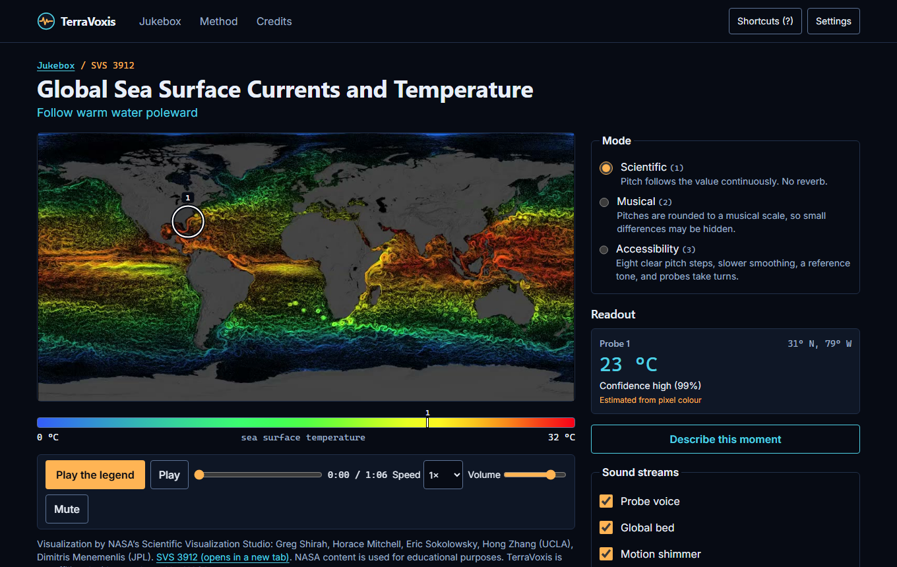

<div align="center">

# 🌍🔊 TerraVoxis

### Hear the data behind the picture

*NASA Space Apps Challenge 2026 · The Earth Information Jukebox*

[](https://github.com/Yash151005/TerraVoxis/actions/workflows/ci.yml)
[](https://github.com/Yash151005/TerraVoxis/actions/workflows/pages.yml)
[](LICENSE)


**[▶ Try the live app](https://yash151005.github.io/TerraVoxis/)** ·
[Methodology](docs/METHODOLOGY.md) ·
[Accessibility](docs/ACCESSIBILITY.md) ·
[Demo script](docs/DEMO_SCRIPT.md)

</div>

---



## 📖 About

**TerraVoxis** is a jukebox of NASA Earth visualizations that you can **listen to**.

It reads the colour legend of each visualization, turns pixel colour back into an *estimated* data
value, and turns that value into sound, live in the browser while the animation plays (for a still
image, a scan line sweeps across it). It is
designed **for blind and low-vision listeners first**, and works for anyone who wants to hear what
the planet is doing.

> **No backend · No accounts · No AI at run time · No cost.** Everything runs in your browser.

## ✨ Features

| | Feature | Description |
|---|---|---|
| 🎨 | **Legend-aware sonification** | Colour becomes an estimated value *before* it becomes sound, so pitch follows the data, not the hue. |
| 📍 | **Listening probes** | Place up to two probes with mouse or keyboard to hear and read the value at that spot. |
| 🎼 | **Audio legend** | Learn the value-to-sound mapping in about ten seconds before playback. |
| 🏷️ | **Provenance labelling** | Every value is marked "Estimated from pixel colour" and shows a confidence level. |
| 🎚️ | **Three listening modes** | Scientific, Musical, and Accessibility (see below). |
| 💾 | **Export** | Download the soundtrack as WAV, plus a JSON file that documents the mapping. |
| 📳 | **Vibration cues** | Opt-in on Android phones: 1 to 4 pulses when probe 1 moves into a new value quarter, and a tap for new lightning. |
| ⌨️ | **Keyboard first** | Every control works from the keyboard, with screen-reader announcements and a "describe this moment" summary. |

### Scenes

| Scene | Source |
|---|---|
| 🌊 Global Sea Surface Currents and Temperature | [NASA SVS 3912](https://svs.gsfc.nasa.gov/3912/) |
| ⚡ Lightning from the ISS, 2017–2023 | [NASA SVS 5011](https://svs.gsfc.nasa.gov/5011/) |
| 🌫️ GEOS Aerosols 2025 | [NASA SVS 5669](https://svs.gsfc.nasa.gov/5669/) |

### Listening modes

| Mode | Pitch | Character |
|---|---|---|
| **Scientific** | Continuous | Precise and unadorned, with an ambient bed. |
| **Musical** | Quantised to a scale | Reverb and a pleasant, melodic result. |
| **Accessibility** | 8 distinct steps | Slower smoothing, a reference tone, and probes heard one at a time for clarity. |

## ⚙️ How it works

```
NASA SVS video ──► pipeline (Python, offline) ──► transcoded media + colour lookup tables + manifest
                                                                    │
                                                                    ▼
Browser:  video frame ──► sample pixels ──► colour → value (LUT) ──► smoothing / events
                                                                    │
                                                                    ▼
                                         mapping (mode) ──► Web Audio graph ──► 🔊
```

1. **Offline pipeline:** fetches the NASA visualizations, transcodes them for the web, and builds
   colour lookup tables from each legend.
2. **Analysis:** samples video frames in the browser and converts colour to an estimated value.
3. **Mapping:** turns values and detected events into pitch, loudness, and timbre, depending on the mode.
4. **Audio:** the Web Audio API renders the sound in real time, or offline for WAV export.

Read the full method in [`docs/METHODOLOGY.md`](docs/METHODOLOGY.md).

## 🚀 Getting started

### Prerequisites

- **Node.js 22+**
- *(Optional, only to rebuild media)* **Python 3.12+**

### Run the app

```sh
git clone https://github.com/Yash151005/TerraVoxis.git
cd TerraVoxis/app
npm ci
npm run dev        # http://localhost:5173
```

| Command | Purpose |
|---|---|
| `npm run dev` | Start the development server |
| `npm run build` | Type-check and build for production (`app/dist`) |
| `npm run preview` | Serve the production build locally |
| `npm run lint` | Lint with oxlint |

The transcoded NASA media, lookup tables, and manifest are committed in `app/public/`, so you **do
not** need to run the pipeline to use the app.

### Rebuild the media (optional)

This downloads about 600 MB from NASA SVS into `pipeline/_cache/`, which git ignores.

```sh
cd pipeline
python -m venv .venv
.venv/Scripts/python -m pip install -r requirements.txt   # Windows; use .venv/bin/python elsewhere
.venv/Scripts/python run_all.py                           # all scenes, or: run_all.py ocean
```

`scenes.py` holds every per-scene setting (legend crop, thresholds, descriptions), with notes on how
each number was chosen. `preview_match.py` writes a false-colour check of the aerosol classification.

## ⌨️ Keyboard shortcuts

| Keys | Action |
|---|---|
| `Space` / `K` | Play or pause |
| `L` | Play or stop the audio legend |
| `D` | Describe this moment |
| `Arrow keys` *(probe focused)* | Move the probe by 1% |
| `Shift` + `Arrow keys` *(probe focused)* | Move the probe by 5% |
| `Tab` | Move between probes and controls |
| `1` / `2` / `3` | Scientific / Musical / Accessibility mode |
| `M` | Mute or unmute |
| `←` / `→` *(seek slider focused)* | Seek 5 seconds |
| `Esc` | Stop the legend or close a dialog |
| `?` | Show the shortcut list |

## 🧪 Testing

```sh
cd app
npm run typecheck
npm test                                # Vitest unit tests
npx playwright install chromium firefox
npm run test:e2e                        # Playwright user journeys + axe accessibility scans
```

[GitHub Actions](.github/workflows/ci.yml) runs type-checking, unit tests, the production build,
and the end-to-end and accessibility suites in Chromium and Firefox on every push and pull request.

## ☁️ Deployment

### GitHub Pages (current)

Push to `main` with *Settings → Pages → Source* set to **GitHub Actions**. The
[`pages.yml`](.github/workflows/pages.yml) workflow builds with
`VITE_BASE_PATH=/<repository-name>/` and publishes the site.

### Cloudflare Pages (optional alternative host)

In the Cloudflare dashboard, go to *Workers & Pages → Create → Pages → Connect to Git*, pick the
repository, then set:

| Setting | Value |
|---|---|
| Root directory | `app` |
| Build command | `npm run build` |
| Build output directory | `dist` |
| Environment variable | `NODE_VERSION=22` (leave `VITE_BASE_PATH` unset) |

`app/public/_headers` sets long cache lifetimes for `/media/*` and `/assets/*`.

> **Hosting limits (checked 13 Nov 2026):** Cloudflare Pages Free allows 25 MiB per file and 20,000
> files, and GitHub Pages sites may be up to 1 GB. The largest file here is 19.6 MB, and all media
> together total 36 MB. Neither host needs a payment method, so don't add one.

## 🗂️ Project structure

```
TerraVoxis/
├── app/                    Web application
│   ├── public/             NASA media, colour lookup tables, scene manifest
│   ├── src/
│   │   ├── a11y/           Announcements, descriptions, speech, shortcuts
│   │   ├── components/     UI components (Stage, Transport, Readout, …)
│   │   ├── engine/
│   │   │   ├── analysis/   Frame sampling, colour → value, smoothing, events
│   │   │   ├── audio/      Web Audio graph, voices, audio legend
│   │   │   ├── mapping/    Modes, scales, feature → sound mapping
│   │   │   └── export/     Offline render, WAV encoder, mapping sidecar
│   │   ├── pages/          Jukebox, Studio, Method, Credits
│   │   ├── scenes/         Manifest loading and validation
│   │   └── state/          Zustand stores and the playback clock
│   └── tests/              Vitest unit tests and Playwright e2e tests
├── pipeline/               Offline media preparation (Python)
├── docs/                   Methodology, accessibility, AI use, demo script, research
└── .github/workflows/      CI and GitHub Pages deployment
```

## 🛠️ Tech stack

- **Frontend:** React 19, TypeScript, React Router 7, Zustand
- **Styling:** Tailwind CSS 4
- **Audio:** Web Audio API (real-time and offline rendering)
- **Build:** Vite
- **Quality:** Vitest, Playwright, axe-core, oxlint
- **Pipeline:** Python 3.12+
- **CI/CD:** GitHub Actions → GitHub Pages

## 📚 Documentation

| Document | Contents |
|---|---|
| [METHODOLOGY.md](docs/METHODOLOGY.md) | How colour becomes a value and a value becomes sound |
| [ACCESSIBILITY.md](docs/ACCESSIBILITY.md) | Accessibility design decisions and testing |
| [AI_USE.md](docs/AI_USE.md) | How AI tools were used to build the project |
| [DEMO_SCRIPT.md](docs/DEMO_SCRIPT.md) | Walkthrough for presenting the app |
| [RESEARCH_REPORT.md](docs/RESEARCH_REPORT.md) | Background research |

## 🙏 Credits

Visualizations by **NASA's Scientific Visualization Studio**:

- **SVS 3912:** Greg Shirah, Horace Mitchell, Eric Sokolowsky; scientists Hong Zhang (UCLA) and
  Dimitris Menemenlis (JPL). <https://svs.gsfc.nasa.gov/3912/>
- **SVS 5011:** Michala Garrison (SSAI), Greg Shirah, Kel Elkins, Alex Kekesi.
  <https://svs.gsfc.nasa.gov/5011/>
- **SVS 5669:** Joseph V. Ardizzone, Helen-Nicole Kostis; scientist Lesley Ott.
  <https://svs.gsfc.nasa.gov/5669/>

## 📖 References

Every external resource TerraVoxis uses or builds on. The same list appears on the app's Credits page
(source: [`app/src/pages/references.ts`](app/src/pages/references.ts)).

**Libraries in the app bundle**
- [React and React DOM](https://react.dev/) (MIT) — user interface
- [React Router](https://reactrouter.com/) (MIT) — page routing
- [Zustand](https://github.com/pmndrs/zustand) (MIT) — state management

**Build, styling and test tools**
- [Tailwind CSS and @tailwindcss/vite](https://tailwindcss.com/) (MIT) — styling
- [Vite](https://vite.dev/) (MIT) — development server and bundler
- [@vitejs/plugin-react](https://github.com/vitejs/vite-plugin-react) (MIT) — React support for Vite
- [TypeScript](https://www.typescriptlang.org/) (Apache 2.0) — type checking and compilation
- [DefinitelyTyped](https://github.com/DefinitelyTyped/DefinitelyTyped) `@types/react`, `@types/react-dom`, `@types/node` (MIT)
- [Vitest](https://vitest.dev/) (MIT) — unit tests
- [Playwright](https://playwright.dev/) (Apache 2.0) — end-to-end browser tests
- [axe-core and @axe-core/playwright](https://github.com/dequelabs/axe-core) (MPL 2.0) — automated accessibility checks
- [oxlint](https://oxc.rs/) (MIT) — linting

**Media pipeline** ([`pipeline/requirements.txt`](pipeline/requirements.txt))
- [Python](https://www.python.org/) (PSF)
- [requests](https://requests.readthedocs.io/) (Apache 2.0) — downloads from the SVS API
- [imageio-ffmpeg](https://github.com/imageio/imageio-ffmpeg) (BSD 2-Clause) — ships the FFmpeg binary
- [FFmpeg](https://ffmpeg.org/) (LGPL/GPL, depending on the build) — video transcoding
- [Pillow](https://python-pillow.org/) (MIT-CMU / HPND) — image handling
- [NumPy](https://numpy.org/) (BSD 3-Clause) — pixel arithmetic

**Research the design relies on** (see [`docs/RESEARCH_REPORT.md`](docs/RESEARCH_REPORT.md) §5 and §19)
- Dubus & Bresin 2013, PLOS ONE — <https://doi.org/10.1371/journal.pone.0082491>
- Walker 2002, J. Exp. Psychol.: Applied — <https://doi.org/10.1037/1076-898X.8.4.211>
- Walker & Mauney 2010, ACM TACCESS — <https://doi.org/10.1145/1714458.1714459>
- Smith & Walker 2005, Applied Cognitive Psychology — <https://doi.org/10.1002/acp.1146>
- McGookin & Brewster 2004, ACM TAP — <https://doi.org/10.1145/1024083.1024087>
- Neuhoff 2019, ICAD — <https://doi.org/10.21785/icad2019.069>
- Sharif et al. 2025 — <https://doi.org/10.1145/3744257.3744263>
- Arcand et al. 2024, Frontiers in Communication — <https://doi.org/10.3389/fcomm.2024.1288896>
- Zanella et al. 2022, Nature Astronomy — <https://doi.org/10.1038/s41550-022-01721-z>
- Poco, Mayhua & Heer 2018, IEEE TVCG — <https://doi.org/10.1109/tvcg.2017.2744320>
- Zhao et al. 2008, ACM TOCHI — <https://doi.org/10.1145/1352782.1352786>
- Kim, Kim & Hullman 2024, CHI (Erie) — <https://doi.org/10.1145/3613904.3642442>
- Biggs et al. 2022, ICAD (Audiom) — <https://doi.org/10.21785/icad2022.027>
- Hermann, Hunt & Neuhoff (eds.) 2011, *The Sonification Handbook* — <https://sonification.de/handbook/downloads/>

**NASA and challenge resources**
- [SVS Earth Information Center gallery](https://svs.gsfc.nasa.gov/gallery/earth-information-center/) and [SVS help and API](https://svs.gsfc.nasa.gov/help/)
- [NASA images and media guidelines](https://www.nasa.gov/nasa-brand-center/images-and-media/)
- [NASA GIBS](https://gibs.earthdata.nasa.gov/) and [GEOS-CF data](https://portal.nccs.nasa.gov/datashare/gmao/geos-cf/v2/) — researched, not used in the app
- [NASA Sounds of the Sea](https://www.nasa.gov/science-research/earth-science/sounds-of-the-sea/) and [Chandra sonifications](https://chandra.si.edu/sound/) — prior work
- [Space Apps 2026: The Earth Information Jukebox](https://www.spaceappschallenge.org/2026/challenges/the-earth-information-jukebox/)

**Existing sonification tools studied**
- [TwoTone](https://github.com/datavized/twotone), [Astronify](https://github.com/spacetelescope/astronify),
  [STRAUSS](https://github.com/james-trayford/strauss), [Erie](https://github.com/see-mike-out/erie-web),
  [Chart2Music](https://github.com/julianna-langston/chart2music), [MAIDR](https://github.com/xability/maidr),
  [PIXELSYNTH](https://github.com/ojack/PIXELSYNTH), [Sonification Design](https://sonification.design/)

**Web platform documentation and services**
- [MDN Web Docs](https://developer.mozilla.org/) — Web Audio API, OfflineAudioContext, requestVideoFrameCallback, autoplay, CORS
- [GitHub Actions and GitHub Pages](https://pages.github.com/) — CI and hosting

**AI tools**
- [Claude (Anthropic), used through Claude Code](https://claude.com/claude-code) — AI coding assistant that helped
  write code and documents; see [`docs/AI_USE.md`](docs/AI_USE.md). No AI runs inside the app.

## ⚠️ Disclaimer

NASA content is used for educational purposes. TerraVoxis is **not affiliated with or endorsed by
NASA**. Values are **estimated from pixel colour and are not measurements**.

## 📄 License

The code is released under the [MIT License](LICENSE). See [`docs/AI_USE.md`](docs/AI_USE.md) for
how AI was used.

<div align="center">

Made with 💙 for NASA Space Apps Challenge 2026

</div>
