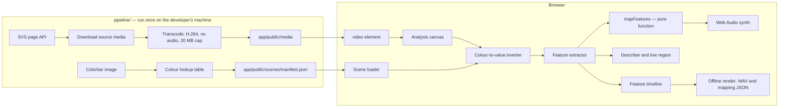

# MASTER PROJECT BUILDING PROMPT — TerraVoxis

Give this whole document to the coding agent. It is self-contained.

---

## 0. Your role and the rules of engagement

You are building **TerraVoxis**, a working web application for the NASA Space Apps Challenge 2026, challenge "The Earth Information Jukebox". The hackathon ends on Sunday 15 November 2026 at 23:59 local time. Scope accordingly: a small thing that works beats a large thing that does not.

All architectural decisions below are final. Do not re-open them, and do not ask which framework or host to use. Ask the user only when this document says "ask the user".

Non-negotiable rules:

1. **Build real functionality.** No mock data, no placeholder audio files, no hard-coded "results". Sound must be synthesised in the browser from the pixels of NASA frames.
2. **Zero cost.** No paid service, no API key, no backend server, no database, no GPU. If you find yourself needing one, stop and choose the simpler path described here.
3. **Scientific honesty.** Values read from pixels are estimates of a rendered picture. The interface must say so everywhere a number appears. Never call them measurements.
4. **Never invent NASA facts.** Scene descriptions come only from section 5 of this document or from the SVS page API at build time.
5. **Do not use the NASA insignia or logotype** anywhere. Credit NASA in text.
6. **Verify, then claim.** Run the tests and the app before saying something works. If something is not done or not tested, say so plainly in your final report.
7. **MVP first.** Finish and verify every MVP item (section 3) before starting any stretch item. Check in with the user at the end of each phase in section 14 with a two-line status.
8. **Existing files.** The working directory `D:\project\TerraVoxis` already contains `agent.mjs`, `models.mjs`, `package.json`, `package-lock.json` and `node_modules` that belong to the user, plus `docs/`. Do not modify or delete them. Create the application under the new subfolders named in section 12.

Facts marked **[verify]** below could not be confirmed during research. Check each one when you reach it, and adapt if it is wrong.

---

## 1. Product

**Name:** TerraVoxis
**Tagline:** Hear the data behind the picture.

**Problem.** NASA's Earth Information Center presents Earth science as visualizations only. Blind and low-vision people are excluded, and sighted people often take in the picture without the quantities.

**Solution.** A jukebox of NASA Earth visualizations in which sound is generated live from the frames. The app reads each visualization's colour legend, turns pixel colour back into an approximate data value, and maps that value to sound through a documented, tested mapping.

**What makes it different.** Present these four together; none is claimed as a world first.

1. **Legend-aware sonification** — colour is inverted to an estimated value before it becomes sound.
2. **Listening probes** — the user places a probe on the image and hears and reads the estimated value there.
3. **Audio legend** — the mapping is taught in ten seconds before playback.
4. **Provenance labelling** — every value shows "estimated from pixel colour" and a confidence.

**Users.** Blind and low-vision learners; visitors to science centres; teachers; science communicators.

**Challenge requirements this must satisfy** (from the official page): pair EIC visual frames with dynamic sonifications generated in real time; balance data interpretation with musically pleasing output; treat accessibility as a core theme, including screen-reader compatibility and rich descriptive text; document the "why" and the algorithms.

---

## 2. Architecture decisions (final)

| Decision | Choice |
|---|---|
| Shape | Static single-page application. All analysis and synthesis in the browser. |
| Backend | None. |
| Database | None. Settings in `localStorage`. |
| NASA media | Downloaded and transcoded once by an offline script, then served from the app's own origin. |
| AI / language models | None in the MVP. |
| Hosting | Cloudflare Pages (primary) and GitHub Pages (mirror). |

**Why media must be self-hosted.** `svs.gsfc.nasa.gov` sends `access-control-allow-origin: https://tempo.multiverse.music` on every response. Any other origin is blocked from `fetch`, and cross-origin video taints the canvas so pixels cannot be read. SVS content is public domain, so copying it is permitted. Never hot-link SVS media at run time and never call the SVS API from the browser.



---

## 3. Scope

### MVP — all required

1. Jukebox page listing scenes from the manifest.
2. Studio page: video playback with live sonification, synchronised.
3. Colour-to-value inversion from each scene's legend.
4. Three sound streams: probe voice, global bed, events.
5. One or two listening probes, movable by pointer and keyboard.
6. Audio legend.
7. Three modes: Scientific, Musical, Accessibility.
8. "Describe this moment" text, announced through a live region.
9. Export: WAV plus a mapping JSON file.
10. Method page and Credits page.
11. Complete keyboard operation and screen-reader labelling.
12. Three scenes: ocean currents (3912), lightning (5011), aerosols still (5669).
13. Tests in section 15 passing; deployed to a public address.

### Stretch — in this order, only after the MVP is verified

1. Fourth scene: GEDI forest height (4950).
2. Exploration mode: a mapping editor (range, polarity, scale, stream levels).
3. Custom local image or video with a user-marked legend.
4. Haptic pulses on events through `navigator.vibrate`, where supported.
5. "Live Earth": a dated global image from NASA Worldview Snapshots.
6. Comparison of two probes by alternation.

### Out of scope

Server code, user accounts, language-model features, 3D rendering, sampled instruments, video export with sound, MP3 export.

---

## 4. Technology stack

Use the current stable release of each. Versions noted were current in November 2026.

| Layer | Use | Notes |
|---|---|---|
| Language | TypeScript, strict mode | |
| UI | React 19 | `ref` is a normal prop; no `defaultProps` on function components |
| Build | Vite | Whatever `npm create vite@latest` (template `react-ts`) installs **[verify]** |
| Styling | Tailwind CSS 4 | Use `@tailwindcss/vite`; put `@import "tailwindcss";` in the CSS; define the theme in CSS with `@theme`; there is no `tailwind.config.js` by default |
| Routing | `react-router` with hash routing | Hash routing avoids server rewrites on GitHub Pages |
| State | Zustand 5 | Named import `create`; use `useShallow` for object selectors |
| Audio | Web Audio API directly | No Tone.js. No `AudioWorklet` needed. |
| Frame timing | `requestVideoFrameCallback`, falling back to `requestAnimationFrame` | |
| Speech | `speechSynthesis`, opt-in | |
| Unit tests | Vitest | |
| End-to-end and accessibility tests | Playwright with `@axe-core/playwright` | |
| Offline pipeline | Python 3.12+, `requests`, `imageio-ffmpeg`, Pillow, NumPy | `imageio-ffmpeg` supplies an FFmpeg binary |

Do not add: Three.js, Framer Motion, OpenCV.js, ffmpeg.wasm, Tone.js, any soundfont, any analytics, any third-party script loaded at run time. Self-host fonts or use system fonts.

---

## 5. Scenes and NASA integration

### 5.1 Resolving media

For each scene the pipeline calls `https://svs.gsfc.nasa.gov/api/<id>`, walks `media_groups[].items[].instance`, and selects the item whose `filename` matches the one named below. Rewrite `http://` to `https://`. If a filename is not found, list the available filenames and stop with a clear message; do not guess.

Useful API facts: top-level `title`, `description`, `credits[]` (`role`, `people[].name`, `people[].employer`), `datasets[]`; instances carry `url`, `filename`, `media_type` (`Image`, `Movie`, `Frames`), `width`, `height` (sometimes 0). File size is not in the JSON.

### 5.2 Scene definitions

**Scene `ocean` — SVS 3912, Global Sea Surface Currents and Temperature**

| Field | Value |
|---|---|
| Source video | `ecco2_sst_flow.mp4` (2048×1024, about 244 MB) |
| Legend image | `sst_ecco2_cbar.png` (310×95) |
| What it shows | Ocean surface current flow lines, coloured by sea surface temperature, from the ECCO2 ocean model, 25 March 2007 to 3 March 2008 |
| Legend | Blue 0 °C; green 10–20 °C; yellow about 25 °C; red 32 °C. Use `vmin = 0`, `vmax = 32`, unit `°C`. |
| Projection | Flat 2:1 global map. Treat as equirectangular: `lon = −180 + 360x`, `lat = 90 − 180y`. **[verify]** by checking that Florida and Gibraltar land where expected; if not, set `geo: null` and omit coordinates. |
| Matching | `hue` (brightness varies with the flow lines, so ignore lightness) |
| Mask | None beyond confidence; land is grey and will fail the chroma test, which is the intended behaviour |
| Streams | Probe voice, bed, motion shimmer |
| Story | Warm water is carried poleward along the western edges of ocean basins; sharp fronts appear where it meets cold water. |
| Credit | NASA's Scientific Visualization Studio. Visualizers Greg Shirah, Horace Mitchell, Eric Sokolowsky; scientists Hong Zhang (UCLA), Dimitris Menemenlis (JPL). |

**Scene `lightning` — SVS 5011, Lightning Events Detected from the ISS 2017–2023**

| Field | Value |
|---|---|
| Source video | `iss_lightning_sos_yearly_07312023_2048p60.mp4` (4096×2048, about 334 MB) — the flat version |
| Legend | None. Yellow-orange dots on a grey Earth show where lightning was detected. |
| What it shows | Lightning detected by the Lightning Imaging Sensor on the International Space Station, 2017 to July 2023, displayed with a roving 10-day window |
| Projection | Flat 2:1, equirectangular. Coverage is limited to the latitudes the station passes over. |
| Matching | `event` — no value inversion |
| Streams | Events, plus a soft activity bed |
| Story | Lightning concentrates over tropical land and follows the summer hemisphere through the year. |
| Honesty note | Each dot is part of a 10-day accumulation, not one flash at that instant. Say so in the scene description. |
| Credit | NASA's Scientific Visualization Studio. Michala Garrison (SSAI), Greg Shirah, Kel Elkins, Alex Kekesi. |

**Scene `aerosols` — SVS 5669, GEOS Aerosols**

| Field | Value |
|---|---|
| Source image | `Aerosols_2025-08-19T20_00_00_1920x1080.png` (about 2.6 MB) |
| Legend image | `Aerosols_cbar.png` (1500×300) — categorical |
| What it shows | Modelled aerosols on 19 August 2025 at 20:00 UTC, from the GEOS Forward Processing system |
| Classes | Black carbon / smoke (red-orange); dust (lilac to magenta); sea salt (grey-teal to blue); sulfate (green). Sample each class colour from the legend image. No units. |
| Projection | Flat map cropped to 16:9. Use `geo: null` unless you can establish the bounds. |
| Matching | `categorical` |
| Playback | Scan mode: a playhead sweeps west to east in 24 seconds |
| Story | Sea salt over windy oceans; Saharan dust crossing the Atlantic; smoke from fires in Africa and Spain; sulfate from volcanoes such as Kilauea and Etna; Hurricane Erin visible in the sea-salt field. |
| Credit | NASA's Scientific Visualization Studio. Joseph V. Ardizzone, Helen-Nicole Kostis; scientist Lesley Ott. |

**Stretch scene `forest` — SVS 4950, GEDI Forest Height**

| Field | Value |
|---|---|
| Source video | `GEDI_global_w_colorbar_1080p60.mp4` (about 17.7 MB) |
| What it shows | Canopy height from the GEDI lidar on the space station; brown and dark green are shorter vegetation, bright green and white are taller. Height is exaggerated in the render. |
| Legend | Burned into the frame. Three colorbars exist on the page (0–40, 0–50, 0–75 m) and the page does not say which this video uses. **Ask the user** to read the numbers off a frame. If unknown, set unit to `relative` and show 0–100%. |
| Projection | Rotating 3D globe. `geo: null`. Mask the colorbar region. Label the scene "screen position only — the globe rotates". |
| Matching | `lab` |
| Credit | NASA's Scientific Visualization Studio. Kel Elkins (USRA), Horace Mitchell, Greg Shirah; scientists Temilola Fatoyinbo, Atticus Stovall. |

### 5.3 Transcoding rules

For every video:

- H.264, `yuv420p`, no audio track (`-an`), `-movflags +faststart`, keyframe interval 15.
- Flat 2:1 scenes: scale to 1024×512. Others: height 720.
- 30 frames per second.
- **Output must be 20 MB or smaller.** Start at CRF 23; raise CRF in steps of 2 up to 31; if still too large, trim to the first 90 seconds. Record what was done in the manifest (`transcode` field).
- Also write a poster JPEG from the frame at one third of the duration.
- Keep downloaded originals in `pipeline/_cache/`, which is git-ignored.

Images: copy as they are if under 5 MB; otherwise resize to 1920 wide.

### 5.4 Attribution

The Credits page and each Studio page show: scene title, "Visualization by NASA's Scientific Visualization Studio", the names above, a link to `https://svs.gsfc.nasa.gov/<id>/`, and the sentence: "NASA content is used for educational purposes. TerraVoxis is not affiliated with or endorsed by NASA."

---

## 6. Data contracts

### 6.1 `app/public/scenes/manifest.json`

```json
{
  "version": 1,
  "generated": "2026-11-14T09:00:00Z",
  "scenes": [
    {
      "id": "ocean",
      "svsId": 3912,
      "title": "Global Sea Surface Currents and Temperature",
      "tagline": "Follow warm water north",
      "svsUrl": "https://svs.gsfc.nasa.gov/3912/",
      "media": {
        "kind": "video",
        "src": "media/ocean.mp4",
        "poster": "media/ocean.jpg",
        "width": 1024, "height": 512, "duration": 0
      },
      "transcode": { "crf": 25, "trimmedSeconds": null, "sourceFile": "ecco2_sst_flow.mp4" },
      "geo": { "projection": "equirectangular", "west": -180, "east": 180, "north": 90, "south": -90 },
      "quantity": { "name": "sea surface temperature", "unit": "°C", "vmin": 0, "vmax": 32, "kind": "continuous" },
      "match": { "method": "hue", "minChroma": 18, "maxDistance": 14 },
      "lut": "luts/ocean.json",
      "masks": [],
      "analysis": { "width": 192, "height": 96 },
      "events": null,
      "streams": ["probe", "bed", "motion"],
      "musical": { "scale": "majorPentatonic", "root": 48, "bpm": 72 },
      "defaultProbes": [ { "x": 0.28, "y": 0.33, "r": 0.03 } ],
      "provenance": "Rendered from the ECCO2 ocean model by NASA SVS. Values here are estimated from pixel colour.",
      "description": "…full text alternative, 80–150 words…",
      "story": "…two sentences…",
      "credits": ["Greg Shirah", "Horace Mitchell", "Eric Sokolowsky", "Hong Zhang", "Dimitris Menemenlis"]
    }
  ]
}
```

Field notes:

- `media.kind` is `video` or `image`.
- `geo` may be `null`.
- `quantity.kind` is `continuous`, `categorical` or `event`.
- `match.method` is `lab`, `hue`, `categorical` or `event`.
- `masks` is a list of rectangles `{x, y, w, h}` in 0–1 coordinates to ignore (legends, insets, labels).
- `events` for the lightning scene: `{ "hueMin": 25, "hueMax": 65, "minChroma": 40, "minLightness": 60, "grid": [48, 24], "maxPerFrame": 12 }`. Tune the numbers against real frames and record the final values.
- Coordinates everywhere are normalised: `x` 0 at the left to 1 at the right, `y` 0 at the top to 1 at the bottom.

### 6.2 `app/public/luts/<scene>.json`

Continuous:
```json
{ "kind": "continuous", "n": 256, "vmin": 0, "vmax": 32,
  "rgb": [[r, g, b], "… 256 entries from vmin to vmax …"] }
```

Categorical:
```json
{ "kind": "categorical",
  "classes": [ { "id": "seaSalt", "label": "Sea salt", "rgb": [[r, g, b], "… 1–4 samples …"] } ] }
```

The pipeline builds a continuous table by sampling the legend image along its long axis at the vertical centre of the colour strip, after cropping away labels and borders. Add the crop rectangle to a small per-scene config in the pipeline so that it is explicit and reviewable. Check that the result runs blue to red for `ocean`.

### 6.3 Core TypeScript types

```ts
type ProbeFeatures = {
  x: number; y: number; r: number;
  value: number | null;        // in data units; null if coverage too low
  u: number | null;            // normalised 0..1
  coverage: number;            // 0..1 fraction of valid pixels
  spread: number;              // std dev of u within the probe
  motion: number;              // 0..1
  confidence: number;          // 0..1
  classFractions?: Record<string, number>;
};

type SceneEvent = { x: number; y: number; strength: number };

type FrameFeatures = {
  t: number;                   // media time, seconds
  global: { u: number | null; coverage: number; motion: number;
            classFractions?: Record<string, number> };
  probes: ProbeFeatures[];
  events: SceneEvent[];
  scanX?: number;              // scan mode playhead, 0..1
};

type VoiceTargets = {
  probe: { freq: number; gain: number; cutoff: number; pan: number; tremolo: number }[];
  bed:   { freq: number; gain: number; cutoff: number };
  classes?: Record<string, number>;           // gains 0..1
  hits: { freq: number; gain: number; pan: number }[];
  noteOn?: { voice: number; midi: number }[]; // Musical mode
};
```

---

## 7. Analysis algorithms

All analysis lives in `app/src/engine/analysis/` as pure functions over `ImageData` or typed arrays, so they can be unit-tested without a browser video.

### 7.1 Frame capture

- Draw the current video frame, or the still image, to a hidden canvas of the scene's `analysis` size (default 192×96; lightning 256×128). Create the 2D context with `{ willReadFrequently: true }`.
- Read with `getImageData` once per analysed frame.
- Analyse at most 20 times per second; skip frames beyond that.
- When the tab is hidden or the video is paused, do not analyse, except once after a seek or probe move so the readout stays current.

### 7.2 Colour conversion

Convert sRGB to CIELAB (D65). Chroma is `C = sqrt(a² + b²)`; hue is `h = atan2(b, a)` in degrees.

### 7.3 Colour-to-value inversion

Precompute, when the scene loads, a 32×32×32 table indexed by quantised RGB (5 bits per channel). Each cell stores the index of the nearest lookup entry and the distance to it.

Distance by method:

- `lab`: Euclidean distance in L, a, b.
- `hue`: Euclidean distance in a and b only, after scaling both colours to a common chroma. A pixel with chroma below `minChroma` is invalid.
- `categorical`: `lab` distance to the nearest sample of each class; the class with the smallest distance wins.

A pixel is **valid** when its distance is at most `maxDistance` and it lies outside every mask. For a valid pixel, `u = index / (n − 1)` and `value = vmin + u × (vmax − vmin)`. Its confidence is `1 − distance / maxDistance`.

### 7.4 Probe features

A probe is a disc of radius `r` (as a fraction of image width). Over the pixels inside it:

- `coverage` = valid pixels ÷ all pixels.
- `u` = confidence-weighted mean of `u`. If coverage is below 0.15, `u` and `value` are `null`.
- `spread` = standard deviation of `u` over valid pixels.
- `confidence` = mean confidence of valid pixels × min(1, coverage ÷ 0.5).
- `motion` = mean absolute difference in lightness between this analysed frame and the previous one, divided by 20, clamped to 0–1.
- For categorical scenes, `classFractions` = share of pixels per class, with unmatched pixels counted in no class.

### 7.5 Global features

The same statistics over the whole frame outside masks.

### 7.6 Scan mode (still images)

A playhead `scanX` moves from 0 to 1 over the scan duration (24 seconds by default), then stops. At each step, compute features over a vertical band 3% of the width wide, centred on the playhead, and treat that band as the "global" region. Probes still work.

### 7.7 Event detection (lightning)

1. A pixel is "lit" when its hue, chroma and lightness fall inside the scene's `events` thresholds.
2. A lit pixel is "new" when the same pixel was not lit in the previous analysed frame.
3. Bin new pixels into the event grid (48×24).
4. Each cell with at least one new pixel yields one event at the cell's centre of mass; `strength = min(1, newPixelsInCell / 6)`.
5. Keep the strongest `maxPerFrame` events.

### 7.8 Smoothing

Before mapping, smooth `u`, `coverage`, `spread` and `motion` with a one-pole filter: `y += (x − y) × (1 − exp(−dt / τ))`, with `τ` = 0.15 s (0.30 s in Accessibility mode). When a value goes from `null` to a number, jump to it instead of gliding. Reset the smoother on seek.

### 7.9 Coordinates and place names

If `geo` is present: `lon = west + x × (east − west)`, `lat = north − y × (north − south)`. Format as "35° N, 140° E", rounded to whole degrees. Do not name places in the MVP.

---

## 8. Sonification mapping

The mapping is one pure function in `app/src/engine/mapping/mapFeatures.ts`:

`mapFeatures(features, sceneConfig, modeConfig, previousState) → { targets: VoiceTargets, state }`

It must not touch the audio context. Both live playback and export call it.

### 8.1 Constants

| Name | Value |
|---|---|
| `F_MIN` | 130.81 Hz (C3, MIDI 48) |
| `F_MAX` | 1046.50 Hz (C6, MIDI 84) |
| Bed range | One octave below the probe range |
| Maximum simultaneous probe voices | 2 |
| Maximum simultaneous event voices | 8 |
| Master ceiling | −6 dBFS before the limiter |

### 8.2 Probe voice

With polarity `p` (+1 by default; −1 flips), let `u' = u` if `p = +1`, else `1 − u`.

| Parameter | Scientific | Musical | Accessibility |
|---|---|---|---|
| Frequency | `F_MIN × (F_MAX / F_MIN)^u'` | MIDI note = nearest scale degree to `48 + 36u'`; `f = 440 × 2^((m − 69) / 12)` | `u'` rounded to 8 equal steps, then the Scientific formula |
| Gain | `0.5 × coverage^0.6`, zero when `u` is null | Same, shaped by a note envelope | Same |
| Filter cutoff | `min(8000, f × (2 + 6 × min(1, spread / 0.25)))` | Same | Fixed at `4f` |
| Tremolo depth | `0.6 × motion` at 6 Hz | `0.3 × motion` | 0 |
| Pan | `0.9 × (2x − 1)` | Same | Same |

Equal-loudness trim: multiply gain by `clamp((f / 440)^−0.25, 0.6, 1.4)`.

Musical-mode note logic: evaluate on a pulse of sixteenth notes at the scene's `bpm`. Trigger a new note only when the target note differs from the sounding note and `u'` has moved by more than half a scale step since the last trigger; otherwise sustain. Scales, as semitone offsets from the root: `majorPentatonic` [0, 2, 4, 7, 9]; `minorPentatonic` [0, 3, 5, 7, 10]; `dorian` [0, 2, 3, 5, 7, 9, 10]. Suggested: ocean major pentatonic; lightning minor pentatonic; aerosols dorian; forest major pentatonic.

When two probes are active, the second uses a different waveform (section 9) and is one stream; in Accessibility mode the two alternate every 1.2 seconds instead of sounding together.

### 8.3 Bed

- Frequency from the global `u` using the probe formula, divided by 2.
- Gain `0.18 × coverage^0.6`; in Accessibility mode the bed is off by default.
- Cutoff `300 + 2500 × motion` Hz.

### 8.4 Events

For each event:

- Frequency: if `geo` is present, from latitude; otherwise from `1 − y`. Let `w = 1 − y`. Scientific: `523.25 × 4^w` (C5 to C7). Musical: nearest scale degree in that range. Accessibility: three bands only (south, tropics, north) at C5, G5, C6.
- Gain: `0.25 + 0.5 × strength`.
- Pan: `0.9 × (2x − 1)`.
- Rate limiting: never start more than 8 event voices within any 100 ms; drop the weakest.
- Accessibility mode: at most 4 events per analysed frame.

### 8.5 Categorical scenes

Each class has its own continuous voice. Gain for class `k` is `0.4 × fraction_k^0.7`, taken from the scan band (or from the probe when a probe is active and the user has selected "probe only"). In Accessibility mode, only the two largest classes sound.

### 8.6 Modes

| Setting | Scientific | Musical | Accessibility |
|---|---|---|---|
| Pitch | Continuous | Scale-quantised | 8 steps |
| Reverb | Off | Light | Off |
| Bed | On | On | Off |
| Smoothing τ | 0.15 s | 0.15 s | 0.30 s |
| Reference tone | Off | Off | On |
| Probes sounding together | Yes | Yes | No, alternate |

The mode is shown as a labelled radio group. Under the Musical option, show the note: "Pitches are rounded to a musical scale, so small differences may be hidden."

### 8.7 Reference tone

Optional. A soft, short click-tone every 2 seconds at the pitch of a reference value (default: the middle of the range; for `ocean`, 16 °C). It tells the listener whether the probe is above or below that value.

### 8.8 Audio legend

A scripted sequence that uses the real synth voices. Each step updates the live region and, if speech is on, speaks the label first.

- Continuous scenes: "Lowest: 0 °C" then a 0.8 s tone at `u = 0`; "Middle: 16 °C" then `u = 0.5`; "Highest: 32 °C" then `u = 1`; then a 2 s glide from low to high; then "Louder means more data under the probe. Left and right follow west and east."
- Event scenes: one event tone for south, one for the tropics, one for north; then left, centre, right.
- Categorical scenes: each class name followed by 1 s of its voice.

The legend can be stopped at any time with Escape.

---

## 9. Audio engine

Location: `app/src/engine/audio/`.

### 9.1 Graph

Build the graph with one function, `buildGraph(ctx: BaseAudioContext, scene)`, used for both `AudioContext` and `OfflineAudioContext`.

```
probe voice i:  oscillator(s) → low-pass filter → tremolo gain → voice gain → stereo panner ┐
bed:            2 detuned oscillators → low-pass filter → gain ────────────────────────────┤
class voices:   source per class → filter → gain ──────────────────────────────────────────┤→ mix bus
event voices:   pooled: oscillator → envelope gain → stereo panner ───────────────────────┤
reference tone: oscillator → envelope gain ────────────────────────────────────────────────┘
mix bus → high-pass 40 Hz → (reverb send, Musical only) → master gain → compressor as limiter → destination
```

### 9.2 Timbres

| Voice | Recipe |
|---|---|
| Probe 1 | Triangle plus a sine one octave up at 20% level |
| Probe 2 | Square through a low-pass at `2.5f`, at 60% level |
| Bed | Two sawtooth oscillators detuned by ±6 cents, low-passed |
| Event | Sine with a 4 ms attack and a 140 ms exponential decay; add a triangle at twice the frequency for the first 30 ms |
| Sea salt | Looping white-noise buffer through a band-pass at 1800 Hz, Q 0.7 |
| Dust | Sawtooth at 110 Hz through a low-pass at 500 Hz, with slow 0.3 Hz amplitude wobble |
| Smoke / black carbon | Two sines at 82 Hz and 87 Hz (a slow beat), plus low-passed noise at 15% |
| Sulfate | Sines at 880, 1320 and 1760 Hz with staggered slow tremolo |
| Reference | Sine, 40 ms, at −18 dB relative to the probe |

Generate the noise buffer from a seeded pseudo-random generator so that offline renders are identical.

Reverb (Musical only): a convolver with a generated impulse response — 1.6 s of seeded noise with exponential decay — at a send level of 0.18. If this costs too much time, omit reverb and say so.

### 9.3 Parameter updates

- Continuous parameters: `param.setTargetAtTime(value, time, 0.04)`.
- Never set a gain abruptly; all starts and stops ramp over at least 10 ms.
- Event voices come from a fixed pool of 8; steal the oldest when full.

### 9.4 Lifecycle

- Create the `AudioContext` on the first user gesture, and call `resume()` inside that handler.
- If the context is `suspended` or `interrupted`, show a visible "Enable sound" button.
- Pausing the video ramps the master gain to zero in 50 ms; playing ramps it back.
- A master volume slider and a mute button are always visible.
- The limiter is a `DynamicsCompressorNode` with threshold −6 dB, ratio 20, attack 3 ms, release 250 ms.

### 9.5 Synchronisation

The video clock is the only clock. For each analysed frame, compute targets and apply them at `ctx.currentTime + 0.02`. Do not build an independent audio timeline during live playback. On seek, silence in 30 ms, reset smoothers and the previous-frame buffer, then resume.

---

## 10. Export

Location: `app/src/engine/export/`.

1. **Feature pass.** Pause playback. Step the video from 0 to its duration at 10 steps per second: set `currentTime`, await the `seeked` event, analyse, store `FrameFeatures`. Show progress and allow cancel. Cap the export at 120 seconds. For still scenes, generate the scan timeline directly.
2. **Render.** Create an `OfflineAudioContext` (2 channels, 44,100 Hz, the timeline's length plus 1 second). Call `buildGraph`. Walk the timeline, calling `mapFeatures` for each step and scheduling the targets at each step's time.
3. **Encode.** Write a 16-bit PCM WAV with a hand-written 44-byte header. Normalise only if the peak exceeds −1 dBFS.
4. **Sidecar.** Download `<scene>-<mode>.mapping.json` containing: app version; scene id and SVS URL; mode and all mapping settings; probe positions; the constants of section 8.1; the lookup-table file name; a `provenance` string; and the statement "Values are estimated from pixel colour in a NASA SVS rendering and are not measurements."
5. Offer both files as downloads. Announce completion in the live region.

---

## 11. Interface

### 11.1 Identity

"An instrument panel for the planet." Dark, calm, and never brighter than the NASA image.

| Token | Value |
|---|---|
| Background | `#070B14` |
| Surface | `#0F1726` |
| Border | `#22304A` |
| Text | `#E8EEF7` |
| Muted text | `#9FB0C8` |
| Sound accent | `#FFB454` |
| Data accent | `#4FD1E5` |
| Danger | `#FF6B6B` |
| Headings | Space Grotesk, or system sans if not self-hosted |
| Body | Inter, or system sans |
| Values | JetBrains Mono, or system monospace |

Check every text and control pairing for contrast: 4.5:1 for text, 3:1 for control boundaries and focus rings. A high-contrast setting switches to pure black and white with a yellow focus ring. Avoid a generic card-grid dashboard look.

### 11.2 Pages and routes

| Route | Page | Contents |
|---|---|---|
| `#/` | Jukebox | Name and tagline; one sentence on what the app does; scene "records" (poster, title, tagline, quantity, kind of sound); link to Method |
| `#/scene/:id` | Studio | See 11.3 |
| `#/method` | Method | The mapping table; modes; limits; how it was tested; link to the repository |
| `#/credits` | Credits | Per-scene attribution; licences; the non-endorsement sentence; the AI-use statement |

A skip link, a header with the four destinations, and a Settings button are on every page.

### 11.3 Studio layout

Wide screens: stage on the left (about two thirds), panel on the right. Narrow screens: stage on top, panel below, transport fixed at the bottom.

**Stage**
- The video or image, with an overlay layer for probes and the scan line.
- Each probe is a focusable control with a visible ring and a number.
- The legend strip under the stage: the scene's colour scale with its minimum and maximum, and a marker at the current probe value.

**Transport**
- Play or pause; a seek slider; time; playback rate (0.5×, 1×, 2×); volume; mute.
- "Play the legend" — the first and most prominent button when a scene opens.

**Panel**
- Mode radio group.
- Readout per probe: value with unit, coordinates if available, confidence as a word (high, medium, low) and a percentage, and the provenance label "Estimated from pixel colour".
- "Describe this moment" button.
- Stream toggles: probe, bed, events or classes, reference tone.
- "Add probe" and "Remove probe" (maximum two).
- Polarity toggle: "Higher pitch means more" or "Higher pitch means less".
- Export button.
- A collapsible "About this scene": story, full description, credits.

**States**
- Loading: poster with a progress indicator, and the text "Loading NASA media".
- Media failed: an explanation, a retry button, and a link to the SVS page.
- Sound blocked: an "Enable sound" button.
- Low confidence: the readout says "No reliable reading here" and the voice fades out.

### 11.4 Describe this moment

Built from templates, not generated. Examples:

- Continuous with coordinates: "Probe 1 at 55° north, 50° west. Estimated sea surface temperature 4 °C, in the lowest fifth of the scale. Confidence high. Estimated from pixel colour."
- No reading: "Probe 1 is over an area with no data colour, probably land."
- Events: "About 9 lightning events on screen, mostly in the centre and right, in the tropics."
- Categorical: "At the scan line: mostly sea salt, some dust. Position 40% of the way from west to east."
- Add the trend when known: "rising", "falling" or "steady", from the change in smoothed `u` over the last 2 seconds.

### 11.5 Keyboard

| Key | Action |
|---|---|
| Space or K | Play or pause |
| L | Play or stop the audio legend |
| D | Describe this moment |
| Arrow keys, when a probe has focus | Move the probe by 1% |
| Shift with arrow keys | Move by 5% |
| Tab | Move between probes and controls |
| 1, 2, 3 | Scientific, Musical, Accessibility |
| M | Mute |
| Left and Right, when the seek slider has focus | Seek 5 seconds |
| Escape | Stop the legend or close a dialog |
| ? | Show the shortcut list |

Single-letter shortcuts are active only when focus is not in a text field, and can be turned off in Settings.

### 11.6 Accessibility requirements

- Nothing sounds until the user acts.
- Semantic HTML first; ARIA only where needed. Landmarks, one `h1` per page, labelled controls.
- One `role="status"` polite live region, present from page load. One `role="alert"` region for errors. Never announce more often than once every 3 seconds unless the user asked.
- Probes: `role="slider"` is wrong for two dimensions. Use a focusable button with `aria-roledescription="listening probe"`, an `aria-label` such as "Probe 1, 55° north 50° west, 4 °C", and `aria-keyshortcuts`. Update the label on move; announce on key release, not on every step.
- All sliders have `aria-valuetext` with units.
- Dragging always has a keyboard alternative.
- Targets are at least 24×24 CSS pixels.
- Focus is always visible and never hidden behind the fixed transport.
- Respect `prefers-reduced-motion`: no decorative animation, and the scan line moves in steps.
- Add no flashing effects. The lightning video is shown as NASA made it.
- Speech (`speechSynthesis`) is off by default, with a setting "Speak descriptions aloud (turn off if you use a screen reader)". Split speech into sentences.
- Every scene has a full text description, available without playing anything.
- The page language is set; the title changes per route.

### 11.7 Settings

Stored in `localStorage` under the key `terravoxis.settings.v1`: speech on or off; shortcuts on or off; high contrast; reduced motion override; default mode; polarity; master volume.

---

## 12. Repository structure

```
D:\project\TerraVoxis\
├─ app/                              the web application
│  ├─ index.html
│  ├─ vite.config.ts                 base path from an environment variable
│  ├─ public/
│  │  ├─ media/                      transcoded NASA media and posters
│  │  ├─ scenes/manifest.json
│  │  ├─ luts/*.json
│  │  └─ _headers                    cache rules for Cloudflare Pages
│  ├─ src/
│  │  ├─ main.tsx, App.tsx, styles.css
│  │  ├─ pages/                      Jukebox, Studio, Method, Credits
│  │  ├─ components/                 Stage, ProbeHandle, LegendStrip, Transport,
│  │  │                              ModePicker, Readout, StreamToggles, ExportDialog,
│  │  │                              SettingsDrawer, ShortcutHelp, LiveRegion, SkipLink
│  │  ├─ engine/
│  │  │  ├─ analysis/                color.ts, lut.ts, features.ts, events.ts,
│  │  │  │                           scan.ts, smoothing.ts, frameSource.ts
│  │  │  ├─ mapping/                 mapFeatures.ts, scales.ts, modes.ts, constants.ts
│  │  │  ├─ audio/                   buildGraph.ts, voices.ts, engine.ts, legend.ts, noise.ts
│  │  │  └─ export/                  featurePass.ts, renderOffline.ts, wav.ts, sidecar.ts
│  │  ├─ scenes/                     loadManifest.ts, types.ts
│  │  ├─ a11y/                       describe.ts, announce.ts, speech.ts, shortcuts.ts
│  │  ├─ state/                      useStudioStore.ts, useSettingsStore.ts
│  │  └─ lib/                        geo.ts, format.ts, prng.ts
│  ├─ tests/
│  │  ├─ unit/                       one file per engine module
│  │  └─ e2e/                        journey.spec.ts, a11y.spec.ts
│  └─ package.json
├─ pipeline/                         offline media preparation (Python)
│  ├─ requirements.txt
│  ├─ scenes.py                      per-scene config: SVS id, filenames, legend crop, masks
│  ├─ fetch_svs.py                   API lookup and download with resume
│  ├─ transcode.py                   FFmpeg rules of section 5.3
│  ├─ build_lut.py                   legend image to lookup table
│  ├─ build_manifest.py              writes manifest.json
│  ├─ run_all.py                     runs the four steps in order
│  └─ _cache/                        git-ignored originals
├─ docs/
│  ├─ RESEARCH_REPORT.md             already present
│  ├─ MASTER_BUILD_PROMPT.md         this file
│  ├─ METHODOLOGY.md                 mappings, limits, measured errors
│  ├─ ACCESSIBILITY.md               what was tested and how
│  ├─ AI_USE.md                      disclosure for the submission
│  └─ DEMO_SCRIPT.md                 the 30-second video plan
├─ .github/workflows/                ci.yml, pages.yml
├─ .gitignore
├─ LICENSE                           MIT for the code
└─ README.md
```

Module responsibilities:

| Module | Responsibility |
|---|---|
| `analysis` | Pixels to features. Pure. No audio, no DOM beyond a canvas in `frameSource`. |
| `mapping` | Features to sound targets. Pure. |
| `audio` | Targets to sound. Owns the audio context. |
| `export` | Timeline to WAV and sidecar. |
| `a11y` | Words, announcements, speech, shortcuts. |
| `pipeline` | Everything that touches NASA servers. |

---

## 13. "API" contracts

There is no server. The only network requests at run time are for the app's own static files:

| Request | Returns | On failure |
|---|---|---|
| `GET scenes/manifest.json` | The manifest (6.1) | Full-page error with retry |
| `GET luts/<id>.json` | Lookup table (6.2) | Scene opens in "no values" state with an explanation |
| `GET media/<file>` | Video or image, with range support from the host | Scene card disabled with a message; link to SVS |

Validate the manifest and lookup tables at load with a small hand-written validator; report the first problem in words.

Internal module interfaces to keep stable:

| Function | Purpose |
|---|---|
| `loadManifest(): Promise<Manifest>` | Fetch and validate |
| `createInverter(lut, match): Inverter` | Build the 32³ table |
| `extractFeatures(imageData, prevLightness, scene, probes, t): FrameFeatures` | Section 7 |
| `mapFeatures(features, scene, mode, state)` | Section 8 |
| `buildGraph(ctx, scene): Graph` | Section 9 |
| `applyTargets(graph, targets, time)` | Parameter scheduling |
| `runFeaturePass(video, scene, probes, onProgress, signal): Promise<FrameFeatures[]>` | Export step 1 |
| `renderOffline(timeline, scene, mode): Promise<AudioBuffer>` | Export step 2 |
| `encodeWav(buffer): Blob` | Export step 3 |
| `describe(features, scene): string` | Section 11.4 |

Stretch only — "Live Earth": NASA Worldview Snapshots allow any origin and need no key. Request form:
`https://wvs.earthdata.nasa.gov/api/v1/snapshot?REQUEST=GetSnapshot&TIME=<YYYY-MM-DD>&BBOX=-90,-180,90,180&CRS=EPSG:4326&LAYERS=<layer>&FORMAT=image/png&WIDTH=1024&HEIGHT=512`
Verified layer names: `GHRSST_L4_MUR_Sea_Surface_Temperature`, `VIIRS_Black_Marble`, `GEDI_ISS_L3_Canopy_Height_Mean_RH100_201904-202303`, `LIS_ISS_Flash_Count`, `OCO-2_Carbon_Dioxide_Total_Column_Average`. Load the image with `crossOrigin="anonymous"`. The colour-to-value table for each layer should come from the GIBS colormap files **[verify — the address `https://gibs.earthdata.nasa.gov/colormaps/v1.3/<layer>.xml` was not checked]**. If no colormap can be obtained, do not show values for that layer.

---

## 14. Implementation phases

Complete each phase's check before moving on. Report status to the user after each.

| Phase | Work | Done when |
|---|---|---|
| 1. Pipeline | Python environment; fetch, transcode, lookup tables, manifest for `ocean`, `lightning`, `aerosols` | The three media files exist, each 20 MB or smaller; the manifest validates; the ocean lookup table runs blue to red |
| 2. Skeleton | Vite app, Tailwind, routes, stores, manifest loading, Jukebox page, Studio page playing video | Each scene opens and plays silently |
| 3. Analysis | Colour, inverter, features, events, smoothing, scan; unit tests | Analysis unit tests pass; a debug overlay shows the probe value changing as it moves |
| 4. Audio | Graph, voices, engine, `mapFeatures`, modes; unit tests | In `ocean`, moving the probe from warm to cold water lowers the pitch; lightning crackles in time with dots; aerosols scan plays four voices |
| 5. Studio interface | Probes, legend strip, transport, readout, mode picker, stream toggles | The whole journey works with a mouse |
| 6. Accessibility | Keyboard, live region, describe, audio legend, settings, speech | The whole journey works with the keyboard alone; axe reports no serious or critical issues |
| 7. Export and pages | Feature pass, offline render, WAV, sidecar; Method and Credits pages | A downloaded WAV plays and matches what was heard; the sidecar is valid JSON |
| 8. Test and deploy | Full test run; CI; deploy to both hosts | Public addresses load and play on a second device |
| 9. Hand-over | README and docs; demo script | Section 17 is complete |
| Stretch | In the order of section 3 | Each verified the same way |

**Checkpoint.** If phase 4's check is not met for `ocean` by the halfway point of the available time, tell the user, drop `aerosols`, and simplify to one probe voice and events.

---

## 15. Tests

### 15.1 Unit tests (Vitest)

Build synthetic `ImageData` in the tests; do not depend on media files.

| Test | Pass condition |
|---|---|
| sRGB to CIELAB | Known colours within 0.5 of reference values |
| Inversion, `lab`, on a synthetic gradient drawn from a lookup table | Mean absolute error of `u` below 0.02 |
| Inversion, `hue`, with lightness scaled by 0.5 to 1.0 | Mean absolute error of `u` below 0.05 |
| Grey pixels under `hue` matching | Reported invalid |
| Masked pixels | Excluded |
| Probe coverage and null behaviour | `value` is null below 15% coverage |
| Monotonicity | For `u` from 0 to 1 in 100 steps, frequency never decreases (Scientific) and never decreases (Musical, Accessibility); rank correlation above 0.98 |
| Polarity flip | Frequency order reverses |
| Frequency bounds | Always within `F_MIN` and `F_MAX` for probes |
| Scale quantisation | Every Musical note belongs to the scale |
| Event detection on synthetic flashes | Precision and recall at least 0.9 over 200 random frames |
| Event cap and rate limit | Never more than `maxPerFrame` |
| Smoothing | Step response reaches 63% in about τ |
| Coordinates | Corners and centre map to the right latitude and longitude |
| WAV encoder | Correct header; length matches; round-trips sample values |
| Describe | Expected sentences for fixed inputs, including the no-reading case |
| Sidecar | Contains every required field |
| Manifest validator | Accepts the real manifest; rejects three broken ones with clear messages |

If the test environment lacks `OfflineAudioContext`, test determinism and peak level in Playwright instead: render twice, compare sample for sample, and confirm that no sample exceeds 0.891 (−1 dBFS).

### 15.2 End-to-end tests (Playwright, Chromium)

Launch with the flag that allows audio without a gesture, or click first.

- Journey: open the Jukebox, choose `ocean`, play the legend, play, move a probe with the arrow keys, press D, and confirm that the live region contains "°C" and "Estimated from pixel colour".
- Confirm that the audio context is running and that an `AnalyserNode` tapped from the master reports a non-zero signal during playback and near silence when paused.
- Keyboard only: complete the journey without pointer events.
- axe scan on all four routes: zero serious or critical violations.
- Media failure: block a media request and confirm the error state.

### 15.3 Manual checks — report results honestly

- Firefox and Safari if available; one phone.
- A screen reader pass (NVDA on Windows). If you cannot run one, say so and ask the user to.
- Synchronisation: record the screen with sound on the lightning scene and confirm that tones follow dots without a perceptible delay (target under 120 ms).
- Real-video inversion error: point a probe at ten places whose colour clearly matches a legend label and note the readings. Put the outcome in `METHODOLOGY.md` whatever it is.

### 15.4 Performance targets

| Measure | Target |
|---|---|
| Analysis time per frame | Under 4 ms on a mid-range laptop |
| Dropped audio or crackle | None in a 2-minute run |
| JavaScript bundle, compressed | Under 300 kB |
| Time to first scene playable on a good connection | Under 5 seconds |
| Memory during export of 120 s | Under 300 MB |

Measure with `performance.now()` marks and report the numbers you observe.

---

## 16. Security, privacy and configuration

- No secrets exist. Do not create any. Any `VITE_` variable is public by design.
- The only environment variable is `VITE_BASE_PATH`, for the GitHub Pages sub-path. Provide `.env.example`.
- Custom media (stretch) is read with `URL.createObjectURL` and never leaves the device. Limit files to 200 MB and to image and video types; revoke object URLs when done.
- Set a content security policy in `index.html`: default to self; allow `blob:` and `data:` for media and images; add `https://wvs.earthdata.nasa.gov` to image sources only if Live Earth is built; no inline scripts.
- No analytics, cookies or trackers.
- Add `rel="noopener noreferrer"` to external links.

---

## 17. Deployment and documentation

### Deployment

1. Initialise a git repository if there is none. Add a `.gitignore` covering `node_modules`, `dist`, `pipeline/_cache`, `.env`, and Python caches. Do not commit or push until the user asks; when asked and on the default branch, create a branch first.
2. Commit the transcoded media as ordinary files. Do not use Git LFS.
3. `ci.yml`: install, type-check, unit tests, build, on every push.
4. `pages.yml`: build with `VITE_BASE_PATH=/<repository-name>/` and deploy with the official GitHub Pages actions. Use the current major versions of those actions **[verify]**.
5. Cloudflare Pages: write the steps in the README for the user to connect the repository (build command `npm run build`, output `app/dist`, root `app`). The user must do this, since it needs their account. Add `public/_headers` with long cache lifetimes for `/media/*` and `/assets/*`.
6. Before relying on the hosts, check two limits that could not be verified during research: the Cloudflare Pages per-file limit (believed to be 25 MiB) and the GitHub Pages site limit (believed to be 1 GB). Sources: `https://developers.cloudflare.com/pages/platform/limits/` and `https://docs.github.com/en/pages/getting-started-with-github-pages/github-pages-limits`.

### Documents to write

| File | Contents |
|---|---|
| `README.md` | What it is; a screenshot; how to run the pipeline and the app; how to test; how to deploy; credits |
| `docs/METHODOLOGY.md` | Every mapping with its formula; the modes; the inversion method; measured errors; limits, stated plainly |
| `docs/ACCESSIBILITY.md` | Features; shortcuts; what was tested, with which tools; known gaps |
| `docs/AI_USE.md` | A plain statement of which AI tools were used to build the project and for what. Space Apps requires this disclosure. State that no AI model runs inside the app and that all sound is produced by deterministic algorithms. |
| `docs/DEMO_SCRIPT.md` | The 30-second plan below |

### Demo plan

The submission requires a video of 30 seconds or less, or up to seven slides, at a public link.

| Seconds | Content |
|---|---|
| 0–4 | Caption on black: "What does the ocean sound like?" |
| 4–9 | The audio legend: three tones, labelled 0, 16 and 32 °C |
| 9–18 | A probe dragged up the Gulf Stream; the pitch falls; the readout is visible |
| 18–24 | The lightning scene; crackle follows the dots |
| 24–28 | The describe text on screen: "Estimated sea surface temperature 4 °C" |
| 28–30 | Name, tagline, address |

---

## 18. Cost constraints

| Item | Rule |
|---|---|
| Hosting | Free static hosting only. Never add a payment method. |
| Media weight | Total under 100 MB; each file 20 MB or smaller. |
| Services | No Netlify (the free plan pauses the site at 300 credits), no Hugging Face Spaces (creating Docker or Gradio Spaces now needs a paid plan), no Fly.io, Railway or Cloudflare R2. |
| Libraries | Permissive licences only (MIT, BSD, Apache-2.0, ISC). No GPL or AGPL code in the bundle. |
| Fonts and assets | Open licences, self-hosted, or system fonts. |
| Compute | Must run on an ordinary laptop without a GPU. |

Expected total cost: zero.

---

## 19. Acceptance criteria

The project is complete when every line below is true and you have checked it yourself.

**Function**
- [ ] Three scenes play with sound generated live from their frames.
- [ ] In `ocean`, moving a probe from warm to cold water lowers the pitch, and the readout shows a plausible temperature with a unit.
- [ ] In `lightning`, tones coincide with new dots, pan follows left and right, and pitch follows north and south.
- [ ] In `aerosols`, the scan produces four distinguishable voices whose levels follow the classes under the scan line.
- [ ] The audio legend plays for each scene and can be stopped.
- [ ] The three modes sound different and behave as specified.
- [ ] Pause silences the sound; seek does not leave stuck notes.
- [ ] Export produces a WAV that plays, and a valid mapping file.

**Honesty**
- [ ] "Estimated from pixel colour" is visible wherever a value is shown, and in the export sidecar.
- [ ] The Method page states the limits, including the measured inversion error.
- [ ] Each scene credits NASA's Scientific Visualization Studio and links to its SVS page.
- [ ] No NASA logo appears anywhere.

**Accessibility**
- [ ] The whole journey can be completed by keyboard alone.
- [ ] No sound plays before a user action.
- [ ] Automated scan: zero serious or critical issues on all routes.
- [ ] "Describe this moment" works and is announced.
- [ ] Reduced-motion and high-contrast settings work.

**Quality**
- [ ] Unit and end-to-end tests pass in CI.
- [ ] No console errors in normal use.
- [ ] Performance targets of section 15.4 are met, or the shortfall is reported with numbers.
- [ ] Works in current Chrome and Firefox; Safari tested or flagged as untested.

**Delivery**
- [ ] A public address serves the app, and it has been opened on a second device.
- [ ] README and the four documents exist and are accurate.
- [ ] Nothing in the project requires payment or a secret.

---

## 20. Final report to the user

When you finish, or when time runs out, report:

1. What works, checked against section 19, with the public address.
2. What does not work or was cut, without softening.
3. Every **[verify]** item and what you found.
4. Measured numbers: inversion error, analysis time per frame, bundle size, test counts.
5. What the user must do themselves: connect Cloudflare Pages, run a screen-reader pass if you could not, record the demo video, and complete the submission form including the AI-use statement.
