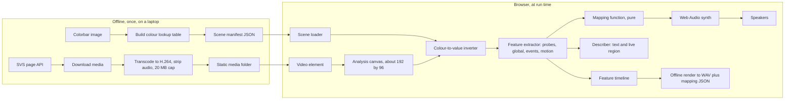
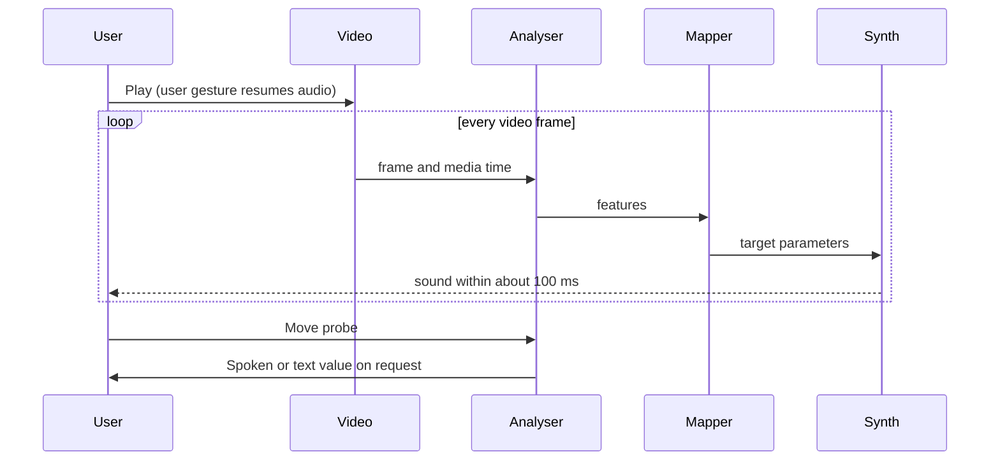

# TerraVoxis — Research Report

NASA Space Apps Challenge 2026, "The Earth Information Jukebox". Research date: 2026-11-13.

## How to read this report

Every claim carries one of three labels.

- **[V] Verified** — fetched from the source on 2026-11-13.
- **[U] Unverified** — recalled from background knowledge; the page could not be fetched today. Check the linked URL before relying on it.
- **[P] Proposed** — a design decision or judgement made in this report, not a fact about the world.

Research limits you should know about:

- Search engines were largely blocked. NASA, GitHub, npm, PyPI, MDN and a few vendor docs were fetched directly; most hosting and LLM pricing pages were not.
- Only 2 of roughly 47 competing 2026 repositories were inspected.
- No trademark database was searched.
- Nothing was built or measured. All performance figures are estimates.

---

## 1. Executive summary

**The challenge.** NASA's Earth Information Center (EIC) shows Earth science as visuals only, which excludes blind and low-vision people. Teams must build an "Earth Jukebox" that pairs EIC visual frames with sonifications generated in real time, balancing data interpretation with musicality. Accessibility is named as a core theme. [V]

**The deadline.** The hackathon runs 14–15 November 2026. Submissions close Sunday 15 November at 23:59 local time. [V] The build plan is therefore scoped to about 30 working hours.

**The constraint that decides the architecture.** A browser cannot read pixels from NASA SVS media or call the SVS API from another origin, because SVS allows only one unrelated origin. [V] The media is public domain [V], so the fix is to download it, transcode it and host it alongside the app.

**The concept.** TerraVoxis is a static, client-side web app that does four things existing tools do not combine:

1. **Reads the legend.** It inverts each visualization's colorbar to recover an approximate data value from each pixel, then sonifies that value rather than raw colour.
2. **Lets the listener point.** Movable "listening probes" on the image report the estimated value under them in sound and in words.
3. **Teaches before it plays.** An audio legend plays the lowest, middle and highest value with spoken labels.
4. **Says what it knows.** Every number is labelled as estimated from pixels, with a confidence, and never presented as a NASA measurement.

**Cost.** Zero. No backend, no database, no paid API, no GPU. Hosting is a static site.

**Honest position on novelty.** The field is crowded: about 47 GitHub repositories already target this challenge. [V] Colorbar inversion and provenance labelling were not found in any sonification tool surveyed, but the survey was partial. Claim "we found no tool that combines these", not "first ever".

---

## 2. Challenge analysis

Source: https://www.spaceappschallenge.org/2026/challenges/the-earth-information-jukebox/ [V]

| Item | What the page says |
|---|---|
| Title | "The Earth Information Jukebox". The subtitle "Convert Earth Science Visualizations into Sound" was not seen on the page. |
| Difficulty | Intermediate; Beginner/Youth |
| Subjects | Arts & Multimedia, Earth Science, Software |
| Core ask | "an interface, script, or application that pairs EIC visual frames with dynamic sonifications generated in real time" |
| Accepted forms | Interactive web jukebox, desktop app, backend API, or a playlist of generated audio with an explanation of the process |
| Balance | "soundscapes that balance data interpretation with artistic, musically pleasing outputs" |
| Accessibility | "a core theme": screen-reader compatibility, tactile feedback, rich descriptive text |
| Warning from NASA | "A direct pixel-to-sound translation might result in chaotic noise" — apply scales, harmonies or rulesets |
| Story | Document the "why" and the algorithms |
| Resources | Exactly the 11 SVS links in the brief; "more resources may be added" |

### Event rules that affect the plan [V]

- Teams of at most six.
- The demo is mandatory: **a video of 30 seconds or less, or a slide deck of up to seven slides**, at a public link with no login.
- English is required.
- Use of AI tools must be described in the submission.
- Sources: https://www.spaceappschallenge.org/resources/project-submission-guide/ and https://www.spaceappschallenge.org/resources/participant-faqs/

Whether work done before the opening time is permitted was not checked. Confirm this in the participant FAQ before using any pre-built code.

### Judging criteria [V]

Each is scored 1 to 5. Source: https://www.spaceappschallenge.org/resources/judging-awards-guide/

| Criterion | What judges look for | How TerraVoxis answers [P] |
|---|---|---|
| Impact | Size of the problem; whether it helps others | Blind and low-vision access to EIC content |
| Creativity | Novel concept or meaningful improvement | Legend-aware sonification with probes |
| Validity | Scientific grounding, feasibility, usability | Documented mappings, tests, honest labels |
| Relevance | NASA data as a core component | Every sound is driven by NASA SVS frames |
| Presentation | Clear, engaging demo | A 30-second cut built around one "aha" |

### Three kinds of audio, and which one this is

| Kind | Driven by | Listener can recover data? |
|---|---|---|
| Audio visualization | Audio drives visuals (a spectrum analyser) | Not applicable |
| Artistic soundscape | Mood, loosely inspired by the subject | No |
| Data sonification | Data drives sound through a stated, repeatable mapping | Yes |

TerraVoxis is data sonification with a musical mode layered on top. The rule that separates it from decoration: change the data and the sound must change in a predictable, documented way.

### The user problems to solve [P]

1. A blind visitor cannot tell what an EIC visualization shows, where the high values are, or how they change.
2. A sighted visitor sees a striking animation but does not read the colorbar, so takes away no quantities.
3. An educator has no way to present these visualizations to a mixed-ability class.
4. Existing sonifications are fixed recordings; nobody can ask "what about here?".

---

## 3. NASA resource analysis

### The critical distinction

**No SVS page offers numeric data.** Every item is rendered pixels: videos, stills and frame sequences. [V] Values recovered from colour are approximations of what the visualizer drew, degraded further by video compression. The real measurements live in separate archives (section 3.4).

### 3.1 SVS API and cross-origin behaviour [V]

- Docs: https://svs.gsfc.nasa.gov/help/#apis
- Page API: `GET https://svs.gsfc.nasa.gov/api/<id>` returns JSON with `title`, `description`, `credits`, `datasets[]` and `media_groups[].items[].instance` (`url`, `filename`, `media_type`, `width`, `height`).
- Search API: `GET https://svs.gsfc.nasa.gov/api/search/?search=…&limit=…&offset=…`
- The EIC gallery is page ID 40467 (25 items in 5 sections).
- Gotchas: URLs are returned as `http://`; file size is not in the JSON; some items report width and height of 0; "Frames" URLs are HTML index pages.
- Every response, API and media alike, carries `access-control-allow-origin: https://tempo.multiverse.music`. Other origins are blocked from `fetch`, and cross-origin media taints the canvas.
- Range requests work (`206` with `content-range`).

### 3.2 Each resource

| ID | Title | Phenomenon | Underlying source | Projection | Legend | Smallest useful file |
|---|---|---|---|---|---|---|
| 3912 | Global Sea Surface Currents and Temperature | Surface current flow lines coloured by sea surface temperature, March 2007 – March 2008 | ECCO2 ocean model | Flat 2:1 global map (equirectangular inferred) | Separate PNG: blue 0 °C, green 10–20 °C, yellow about 25 °C, red 32 °C | 14.9 MB webm (960×540); 244 MB mp4 (2048×1024) |
| 5011 | Lightning Events Detected from the ISS | Lightning flashes, 2017–2023, 10-day roving window | ISS LIS (GHRC DAAC) | Flat 2:1 version exists (4096×2048); also globe | None; dots show presence only | 334 MB flat mp4 |
| 5669 | GEOS Aerosols | One still: aerosols on 19 August 2025, 20:00 UTC | GEOS Forward Processing | Flat map cropped to 16:9 | Categorical PNG: black carbon, dust, sea salt, sulfate; no units | 2.6 MB PNG |
| 4950 | GEDI Forest Height | Canopy height from lidar, drawn track by track | GEDI L2B RH100 | 3D rotating globe | Three colorbars (0–40, 0–50, 0–75 m); which video uses which is not stated | 17.7 MB mp4, 6.0 MB webm |
| 5196 | DYAMOND Global Carbon Dioxide | Atmospheric CO2, January–March 2020 | GEOS / DYAMOND model | 3D globe with camera moves | 380–460 ppm; opacity is also data-driven | 6.9 MB mp4 (HEVC) |
| 5313 | Change in Night Lights 2012–2023 | Annual night lights, then a change map | Black Marble (VIIRS) | Flat 32:9 with pop-out insets | Burned in, no numbers: purple is more light, orange is less | 32.7 MB mp4 (HEVC) |
| 5533 | Air Quality Model Runs | CO, PM2.5, O3, NOx during the 2024 fire season | GEOS-CF | Flat and globe versions | Burned-in labels; no units | 179 MB |
| 5425 | Perpetual Ocean 2 | 3D particle trails in western boundary currents, 2021–2023 | ECCO2 | 3D globe with camera moves | Temperature 0–25 °C; salinity 33–36 | 904 MB |
| 4960 | 3D Atmospheric River | Water vapour transport reaching the US West Coast | MERRA-2 | 3D fly-through | Stacked colour tables (not inspected) | 789 MB mp4; a webm exists |
| 13786 | Data Sonification: Caldwell 73 | Hubble image of a star cluster (reference only) | Hubble | Still image | Not applicable | 5.6 MB webm |

How NASA made the Caldwell 73 sonification [V]: a rotating radar sweep sets time; distance from the centre sets pitch; the whole image is a choir; orange and red stars are a marimba; blue stars are a glockenspiel. Credit: SYSTEM Sounds (M. Russo, A. Santaguida). It is the model for the still-image scan mode in TerraVoxis.

### 3.3 Ranking for this project [P]

Scores run from 1 (poor) to 5 (best). For "compute" a 5 means light.

| ID | Science | Visual complexity | Sonification potential | Ease of integration | Media availability | Compute | Live demo | Total |
|---|---|---|---|---|---|---|---|---|
| 3912 Ocean currents | 5 | 4 | 5 | 5 | 5 | 4 | 5 | 33 |
| 5011 Lightning | 4 | 2 | 5 | 4 | 3 | 4 | 5 | 27 |
| 5669 Aerosols (still) | 4 | 4 | 4 | 5 | 5 | 5 | 4 | 31 |
| 4950 GEDI forest | 4 | 3 | 4 | 3 | 5 | 4 | 4 | 27 |
| 5196 CO2 | 5 | 5 | 3 | 2 | 4 | 4 | 4 | 27 |
| 5313 Night lights | 4 | 3 | 3 | 2 | 3 | 4 | 3 | 22 |
| 5533 Air quality | 5 | 5 | 3 | 2 | 2 | 2 | 2 | 21 |
| 5425 Perpetual Ocean 2 | 4 | 5 | 2 | 1 | 1 | 1 | 2 | 16 |
| 4960 Atmospheric river | 4 | 5 | 2 | 1 | 1 | 1 | 2 | 16 |

**Recommended for the MVP, in build order:**

1. **3912 Ocean currents** — flat map, documented colorbar, continuous motion. The hero scene.
2. **5011 Lightning (flat version)** — discrete events, the clearest possible mapping, and a seasonal story.
3. **5669 Aerosols** — a still with four classes, which shows timbre-per-category and the scan mode.
4. **4950 GEDI forest** — the easiest file to ship; add it if time allows. Its colorbar range must be read off the video by a person.

Leave out 5425, 4960 and 5533: the files are too large and the 3D camera removes any fixed link between pixel and place.

### 3.4 Where the real measurements live [V unless noted]

| Topic | Product | Archive | Login | No-login imagery layer (GIBS) |
|---|---|---|---|---|
| Night lights | VNP46A4 v2 | LAADS DAAC | Yes [inferred] | `VIIRS_Black_Marble` |
| Lightning | `isslis_v3_fin` | GHRC DAAC | Yes [inferred] | `LIS_ISS_Flash_Count` |
| Forest height | GEDI L3 gridded, 1 km | ORNL DAAC | Yes [inferred] | `GEDI_ISS_L3_Canopy_Height_Mean_RH100_201904-202303` |
| Ocean | ECCO V4r4 (not the ECCO2 run SVS used) | PO.DAAC | Yes [inferred] | `GHRSST_L4_MUR_Sea_Surface_Temperature` |
| CO2 | `OCO2_GEOS_L3CO2_MONTH` | GES DISC | Yes [inferred] | `OCO-2_Carbon_Dioxide_Total_Column_Average` |

NASA GIBS and Worldview Snapshots need no login and send `Access-Control-Allow-Origin: *`. [V] One request returns a whole-globe image for a chosen date:

`https://wvs.earthdata.nasa.gov/api/v1/snapshot?REQUEST=GetSnapshot&TIME=2016-01-01&BBOX=-90,-180,90,180&CRS=EPSG:4326&LAYERS=VIIRS_Black_Marble&FORMAT=image/jpeg&WIDTH=720&HEIGHT=360`

GIBS tiles are still colour-mapped images, not raw values. GIBS publishes a colormap file per layer that states the value for each colour [U — not fetched; verify at https://gibs.earthdata.nasa.gov/colormaps/v1.3/ before use]. This is the basis of the stretch feature "Live Earth".

### 3.5 Usage rules [V]

- SVS: "All of our content is in the public domain (unless otherwise noted)… free to download, use, and redistribute." https://svs.gsfc.nasa.gov/help/
- Credit each item to "NASA's Scientific Visualization Studio" plus the names on its page.
- Acknowledge NASA as the source; do not imply endorsement. https://www.nasa.gov/nasa-brand-center/images-and-media/
- **Do not use the NASA insignia or logotype.** They are not public domain.
- Licensed music inside some SVS videos is not public domain. Strip the audio track when transcoding.

---

## 4. Existing solutions

### 4.1 Comparison

| Tool | What it does | Input | Runs in browser | Status | What it lacks for this challenge |
|---|---|---|---|---|---|
| TwoTone | No-code data-to-music | Tables | Yes | Original repo archived; fork idle since July 2024 [V] | No image, video or map |
| Astronify (STScI) | Light curves to pitch | 1-D series | No (Python) | v0.11, January 2025 [V] | One dimension, pitch only |
| STRAUSS | Flexible scientific sonification | Arrays | No (Python) | Active, v1.0.3 [V] | No legend decoding, not web |
| sonoUno | Accessible tabular sonification | Tables | Web version exists | Small community [V] | Tables only |
| Highcharts audio charts | Sonified charts with context cues | Chart data | Yes | Commercial [V] | Needs data, not pixels |
| Erie | Grammar for sonification, with auditory legends | Data | Yes | Active [V] | No image or video |
| Chart2Music, MAIDR | Charts for screen-reader users | Charts | Yes | Active [V] | Charts, not geospatial imagery |
| Chandra / SYSTEM Sounds | Hand-made sonifications of space images | Images | Recordings | Active [V] | Not a tool; one design per image; no Earth |
| NASA "Sounds of the Sea" (2022) | Ocean-colour imagery to music | RGB channels | Tool now offline [V] | Not maintained | Raw RGB, not values; not interactive |
| The vOICe | Vision-to-sound sensory substitution | Camera or image | Yes | Live [V] | Encodes geometry, not data |
| PixelSynth | Image-scan synthesiser | Image | Yes | Idle since 2021 [V] | Artistic; no data meaning |
| Audiom | Auditory map viewer for blind users | Vector maps | Yes | Research [V] | Vector data, not science rasters |
| Earth+ (NASA, legacy) | Satellite images for blind students | Images | Unknown | Could not verify | Worth citing as a NASA ancestor |

Key sources: https://twotone.io/about/, https://github.com/spacetelescope/astronify, https://github.com/james-trayford/strauss, https://www.sonouno.org.ar/, https://www.highcharts.com/docs/sonification/getting-started, https://github.com/see-mike-out/erie-web, https://github.com/xability/maidr, https://chandra.si.edu/sound/, https://www.nasa.gov/science-research/earth-science/sounds-of-the-sea/, https://www.seeingwithsound.com/javoice.htm, https://sonification.design/

### 4.2 This year's competition [V]

- GitHub search for "earth jukebox" returns about 47 repositories, most created September–November 2026.
- Two were inspected. Both sonify bundled numeric records with the Web Audio API. One adds an Express backend calling Gemini. Neither README mentions colorbar inversion, video analysis or probes.
- A third site advertises convolutional networks on EIC visuals (not inspected).
- Past years: the 2023 challenge "Immersed in the Sounds of Space" produced no global winner. [V] Sonification alone has not been enough to win.

### 4.3 Where the gaps are

| Capability | Found in existing tools? | Evidence |
|---|---|---|
| Colorbar inversion before sonifying | Not found | The technique exists for re-colouring charts (Poco, Mayhua & Heer 2018), not for sound |
| Honest "estimated from pixels" labelling | Not found | No surveyed tool labels provenance |
| Earth-science video sonification, synced | Rare | A few tiny repositories, none Earth-focused |
| Movable listening probes on science imagery | Rare | Audiom and iSonic do this for vector maps |
| Audio legend | Exists | Erie, Highcharts; supported by Smith & Walker |
| Fully client-side, zero cost | Common | Not a differentiator |
| Audio export with mapping metadata | Partly | MIDI and audio export exist; a bundled mapping sidecar was not found |

---

## 5. Research literature and the design rules it supports

| Finding | Source | Design rule adopted [P] |
|---|---|---|
| Pitch is the most-used dimension for magnitude; spatial audio is used almost only for location and motion. Only 6.1% of 495 published mappings were properly evaluated. | Dubus & Bresin 2013, https://doi.org/10.1371/journal.pone.0082491 [V] | Pitch carries the main value; stereo carries longitude |
| Preferred polarity depends on the concept being shown, and blind and sighted listeners sometimes differ. | Walker 2002, https://doi.org/10.1037/1076-898X.8.4.211; Walker & Mauney 2010, https://doi.org/10.1145/1714458.1714459 [V] | Default to "more is higher"; let the user flip it |
| Reference tones and time ticks improve point estimation; brief training helps as much. | Smith & Walker 2005, https://doi.org/10.1002/acp.1146 [V] | Audio legend and an optional reference tone |
| Identification falls as concurrent sounds rise; distinct timbres and onsets staggered by 300 ms help. | McGookin & Brewster 2004, https://doi.org/10.1145/1024083.1024087 [V] | At most three streams, each with its own timbre |
| Mixing artistic and scientific aims carelessly weakens sonification. | Neuhoff 2019, https://doi.org/10.21785/icad2019.069 [V] | Separate, labelled Scientific and Musical modes |
| Only half of 106 screen-reader users found sonification at least somewhat useful. | Sharif et al. 2025, https://doi.org/10.1145/3744257.3744263 [V] | Sound is always paired with text and optional speech |
| 3,184 respondents reported learning gains and trust from Chandra sonifications (self-report). | Arcand et al. 2024, https://doi.org/10.3389/fcomm.2024.1288896 [V] | Evidence that the format engages; not proof of comprehension |
| Nearly 100 astronomy sonification projects; evaluation and standards are lacking. | Zanella et al. 2022, https://doi.org/10.1038/s41550-022-01721-z [V] | Publish the mapping and test it |
| Pitch is heard roughly logarithmically; keep fundamentals about 100–2000 Hz. | Standard psychoacoustics [U] | Map values to log frequency, C3 to C6 |

Background reading: *The Sonification Handbook* (free chapters), https://sonification.de/handbook/downloads/

The "three streams" limit is a rule of thumb drawn from the stream-segregation findings, not a measured figure.

---

## 6. Project concept and identity

### Concept [P]

**TerraVoxis — hear the data behind the picture.**

A jukebox of NASA Earth visualizations. Pick a scene, hear a ten-second audio legend, then play. The sound is generated live from the frames. Drop a probe anywhere and hear, and read, the estimated value at that spot.

| Aspect | Contribution |
|---|---|
| Main innovation | Legend-aware sonification: colour is turned back into an approximate value before it becomes sound |
| Technical differentiators | Probes; audio legend; one mapping function shared by live playback and offline export; mapping sidecar file |
| Scientific contribution | Documented, tested, monotonic mappings; explicit confidence and provenance |
| Accessibility contribution | Complete keyboard and screen-reader operation; "describe this moment" on demand |
| Artistic contribution | A Musical mode with per-scene scales and timbres chosen to fit the subject |
| Target users | Blind and low-vision learners; museum and EIC visitors; teachers; science communicators |

### Name check

Not legal clearance. No trademark database was searched.

| Name | Conflicts found [V] | Verdict [P] |
|---|---|---|
| **TerraVoxis** | `terravoxis.com` registered 2026-02-06 (no site); an Etsy shop "Terravoxis"; "Terravox" is an active geosurvey company. GitHub and npm are free. | Keep. Least encumbered in software. If the `.com` is not yours, find out whose it is. |
| Terra Vox | Geosurvey company, winery, YouTube channel, 24 repositories | Avoid |
| EarthTones | Music app, nonprofit, R package, 23 repositories | Avoid |
| Sonisphere | Rock festival; a 3D music site | Avoid |
| Earth Jukebox | The challenge's own phrase; about 47 repositories | Avoid as a name |
| Gaiaphone | An existing term for earth-based instruments | Possible fallback |
| Auralis Earth | `auralis.earth` registered; "Auralis" is a known text-to-speech engine | Avoid |

---

## 7. Feature specification

Complexity: S is under 2 hours, M is 2–5 hours, L is more than 5 hours. No feature below requires a paid service.

### Core (MVP)

| Feature | Why | How | Complexity |
|---|---|---|---|
| Scene gallery ("jukebox") | The challenge's central interaction | Cards from a static manifest | S |
| Self-hosted NASA media | Required by the cross-origin finding | Offline script downloads and transcodes | M |
| Live frame analysis | "Generated in real time" | Video drawn to a small canvas each frame | M |
| Colorbar inversion | The main innovation | Lookup table from the legend; nearest-colour match with confidence | M |
| Parameter-mapping synth | Turns values into sound | Web Audio oscillators and filters | L |
| Event sonification | Lightning | New bright pixels trigger short tones | M |
| Listening probes | Exploration; answers "what about here?" | Draggable and keyboard-movable regions | M |
| Audio legend | Literature-backed comprehension aid | Scripted tones with announcements | S |
| Three modes | Separates science from music | Scientific, Musical, Accessibility presets | M |
| "Describe this moment" | Screen-reader users need words | Template sentences from live features | S |
| WAV export with mapping file | Deliverable; reproducibility | Offline render plus JSON sidecar | M |
| Credits and methodology page | NASA rules; judges' Validity score | Static content | S |

### Advanced (only after the MVP works)

| Feature | How | Complexity |
|---|---|---|
| Still-image scan (west-to-east sweep) | Column profiles over time | S |
| Mapping editor (Exploration mode) | Sliders for range, scale, polarity | M |
| Custom image or video upload | Local file only, never uploaded; user marks the legend | M |
| Live Earth | Worldview Snapshots for a chosen date, with GIBS colormaps | L |
| A/B comparison of two times or two probes | Two probes, alternating or panned | M |
| Haptics | `navigator.vibrate` on lightning events (Android only) | S |

### Optional

| Feature | Note |
|---|---|
| Spatial audio with head-related filtering | Stereo panning already carries longitude; this costs CPU for little gain |
| Video export with sound | Needs WebCodecs, which is not available everywhere |
| AI question answering | See below |

### AI: the decision [P]

**No language model in the MVP.** Reasons:

1. Explanations must be scientifically correct. Reviewed static text plus templates filled from measured features is more trustworthy than generated text.
2. Free model quotas are volatile and were not verifiable today.
3. A key cannot be kept secret in a static site.

"Pattern recognition" is delivered by deterministic computer vision, which is explainable to judges. If time remains, add an optional "ask about this scene" box that uses a key the user pastes in, kept in memory only, and that fails silently back to the static text.

---

## 8. Technology stack

### Decision: no backend, no database [P]

The brief asks for a comparison of FastAPI, Node, MongoDB and PostgreSQL. None is needed, and each would add cost or a cold start.

| Need | Chosen | Rejected, and why |
|---|---|---|
| Frame analysis | Canvas 2D in the browser | Server-side OpenCV: needs hosting, adds latency, breaks "real time" |
| Audio | Web Audio API, used directly | Tone.js: fine, but an extra layer for a custom data-driven synth. SuperCollider, FluidSynth: not browser tools |
| Offline rendering | `OfflineAudioContext` | Server-side SciPy or Librosa: needs a server |
| Computer vision library | Hand-written (about 300 lines) | OpenCV.js: 8–10 MB for features not needed |
| Media preparation | Python script run once on a laptop | A hosted pipeline: unnecessary |
| Storage | Static JSON and `localStorage` | Any database: nothing to store |
| Sampled instruments | None in the MVP; synthesis only | SoundFonts: licence checks and download weight |
| Video muxing | Not in the MVP | ffmpeg.wasm: about 31 MB and needs special headers |
| 3D | None | Three.js: no feature needs it |

### Chosen stack

| Layer | Choice | Version note |
|---|---|---|
| Language | TypeScript | |
| UI | React | 19.3 [V] |
| Build | Vite | 7 or 8 [U]; use whatever `npm create vite@latest` installs |
| Styling | Tailwind CSS | 4.3 [V]; configuration now lives in CSS, via `@tailwindcss/vite` |
| State | Zustand | v5 [U] |
| Audio | Web Audio API, `AudioWorklet` not required | `AudioWorklet` has been widely available since 2021 [V] |
| Frame timing | `requestVideoFrameCallback`, falling back to `requestAnimationFrame` | Newly baseline since October 2024 [V] |
| Speech | Web Speech API, opt-in | Voices vary by device [V] |
| Tests | Vitest, Playwright, `@axe-core/playwright` | Versions [U] |
| Media preparation | Python 3.12 with `imageio-ffmpeg`, Pillow, NumPy, `requests` | All pip-installable on Windows [U] |
| CI and hosting | GitHub Actions, Cloudflare Pages, GitHub Pages mirror | Limits [U] |

Framer Motion is omitted: CSS transitions cover the need and respect reduced-motion settings with less code.

---

## 9. Architecture

Design points:

- **The video clock is the master.** Sound reacts to the frame on screen, so synchronisation is inherent. Expected lag is one frame plus about 50 ms of smoothing.
- **One mapping function.** Live playback and export both call the same pure function, so the exported file matches what was heard.
- **Export is deterministic.** The app steps through the video at a fixed rate, records features, then renders offline.
- **Failure handling.** A missing media file disables that card with a message. An unsupported codec shows the poster image and offers scan mode. Audio that cannot start shows a "tap to enable sound" prompt.

---

## 10. Sonification engine

### 10.1 Approaches and where each is used

| Approach | Meaning | Used for |
|---|---|---|
| Parameter mapping | Data values control sound parameters | Probes and the global bed |
| Event-based | Discrete occurrences trigger sounds | Lightning |
| Musical | Values quantised to a scale and a pulse | Musical mode |
| Spatial | Position controls panning | Longitude to stereo |
| Model-based | A virtual object is excited by data | Not used; too costly to explain in 30 seconds |
| Audification | Data played directly as a waveform | Not used; frames are not a waveform |

### 10.2 Colour to value

1. Sample the colorbar along its axis into N colours (N = 256), each tied to a value from `vmin` to `vmax`.
2. Convert both the table and each pixel to CIELAB.
3. For each pixel, find the nearest table entry. The distance is the confidence signal.
4. A pixel is valid if the distance is below a threshold and it is outside the scene's mask.
5. For speed, precompute a 32×32×32 table from quantised RGB to (index, distance).

Two matching styles are needed:

- **Full colour** when brightness is part of the colour scale (GEDI, aerosols).
- **Hue and chroma only** when brightness encodes something else, such as flow strength in 3912 or opacity in 5196.

Limits: compression shifts colours; shading on 3D globes changes brightness; overlapping translucent layers mix colours. This is why every value is labelled as an estimate with a confidence.

### 10.3 Mapping table

`u` is the normalised value: `u = clamp((v − vmin) / (vmax − vmin), 0, 1)`.

| Visual feature | Meaning | Sound parameter | Formula | Heard as | Limit |
|---|---|---|---|---|---|
| Estimated value at a probe | Temperature, height, concentration | Pitch | `f = 130.81 × 8^u` Hz (C3 to C6) | Higher means more | Approximate; depends on the legend |
| Fraction of valid pixels | How much data is under the probe | Loudness | `gain = g0 × c^0.6` | Silence over land or no data | Loudness is a weak quantitative cue |
| Spread of values in the probe | Local gradient or front | Brightness of timbre | Filter cutoff `= f × (1 + 6σ̂)` | Rougher, brighter at fronts | Also rises with compression noise |
| Frame-to-frame change | Motion or activity | Tremolo depth, noise layer | `depth = min(1, m / m_ref)` | Shimmer where currents move | Camera motion on 3D scenes counts as motion |
| Horizontal position | Longitude | Stereo position | `pan = 0.9 × (2x − 1)` | West is left | Meaningless on headphones worn backwards; on mono, lost |
| New bright pixels | Lightning flashes | Short percussive tone | One tone per cluster; pitch from latitude; level from size | Crackle following the storms | Dots are a 10-day window, not single flashes |
| Count of events per second | Storm activity | Density of tones | Capped at 12 per frame | Busy means stormy | Saturates at the cap |
| Category fractions | Aerosol type | Mix of four timbres | `gain_k = fraction_k^0.7` | Each type has its own voice | Mixed pixels are assigned to one class |
| Global mean value | The whole scene's state | Slow drone | Same pitch law, one octave lower | A bed that drifts with the season | On globes, depends on the camera |

### 10.4 Modes

| Mode | Pitch | Timing | Streams | Purpose |
|---|---|---|---|---|
| Scientific | Continuous, logarithmic | Continuous | Probe, bed, events | Fidelity |
| Musical | Quantised to a per-scene scale | Notes on a pulse | Same, with gentle reverb | Pleasure and engagement |
| Accessibility | Eight discrete steps | Slower; one stream at a time | Probe and reference tone | Distinguishability |
| Exploration | User-set | User-set | User-set | Experiment |

### 10.5 Avoiding the usual failures

| Failure | Guard |
|---|---|
| Random noise | Analyse at low resolution; smooth features over 150 ms; ignore low-confidence pixels |
| Misleading sound | Monotonic mappings only; legend before play; provenance label |
| Clutter | Three streams at most; distinct timbres |
| Harsh sound | Fundamentals between 130 and 1047 Hz; limiter; 10 ms fades; master below −6 dBFS |
| Flutter in Musical mode | A new note only when the value moves more than half a scale step |
| Drifting sync | The video clock is the only clock |
| Lost information | "Describe this moment" gives the numbers in words |

### 10.6 How to show the sound carries information

- A synthetic gradient of known values must produce a pitch that rises monotonically (rank correlation above 0.98).
- Swapping the lookup table must change the output.
- Two offline renders of the same input must be identical.
- A listener test: play two probe positions and ask which is warmer. Report the proportion correct, with the number of listeners.

---

## 11. User experience

### Identity [P]

"An instrument panel for the planet", not a dashboard. Dark by default, because the NASA imagery is dark and the image should be the brightest thing on screen.

| Element | Choice |
|---|---|
| Background | Near-black blue `#070B14` |
| Surface | `#0F1726` |
| Text | `#E8EEF7` (well above 4.5:1 on the background) |
| Accent | Amber `#FFB454` for sound and probes |
| Second accent | Cyan `#4FD1E5` for data and legend |
| Type | Space Grotesk for headings, Inter for text, JetBrains Mono for values (all open licences [U]; self-host the files) |
| Motion | Slow and sparse; off under `prefers-reduced-motion` |
| Signature element | A circular "record" selector on the landing page whose grooves are the scene's own colorbar |

References to study: NASA Worldview (map and timeline), Chandra's "A Universe of Sound" (framing of sonifications), Ableton's Learning Music site (teaching sound with minimal controls), earth.nullschool.net (a full-bleed scientific image with a small overlay).

### Pages

| Page | Contents |
|---|---|
| Jukebox (home) | Scene cards; one-line story each; "Start with the legend" |
| Studio | Video with probes; transport; mode switch; legend strip; live readout; describe button; export |
| Method | The mapping table, the limits, the tests |
| Credits | NASA attribution per scene; licences; AI-use statement |
| Settings (drawer) | Speech on or off, shortcuts on or off, high contrast, reduced motion, polarity |

### Journey

1. Land on the jukebox. Choose "Ocean currents".
2. Press "Play the legend". Hear low, middle, high, with labels.
3. Press play. The bed drifts; the probe sings the temperature under it.
4. Move the probe from the Gulf Stream to the Labrador Sea. The pitch falls.
5. Press D. Read or hear: "Probe at 55° north, 50° west. Estimated sea surface temperature 4 °C. Estimated from pixel colour."
6. Export the WAV and its mapping file.

### Accessibility requirements

- Everything works by keyboard. Arrow keys move the probe; Shift makes larger steps.
- Single-key shortcuts can be switched off (WCAG 2.1.4).
- Nothing plays until the user asks (WCAG 1.4.2).
- One polite live region; never announce per frame.
- Speech is opt-in so it does not talk over a screen reader.
- Lightning visuals: no added flashing effects (WCAG 2.3.1).
- Targets at least 24 by 24 CSS pixels; visible focus; sliders carry `aria-valuetext` with units.
- Each scene has a full text description.

WCAG criterion numbers are from memory [U]; confirm against https://www.w3.org/TR/WCAG22/.

---

## 12. API and data design

There are no server endpoints. The brief's endpoint list maps onto static files and in-browser modules as follows.

| Brief's endpoint | Delivered as |
|---|---|
| Resource listing | `GET /scenes/manifest.json` (static) |
| Visualization metadata | Fields in the manifest, copied from the SVS API by the offline script |
| Media processing, frame extraction | Browser module `analysis/` |
| Feature extraction | Browser module `analysis/features` |
| Sonification generation | Browser modules `mapping/` and `audio/` |
| Audio retrieval, export | Browser module `export/` (WAV and JSON download) |
| Custom upload | Local `File` object; nothing leaves the device |
| Explanation generation | Static text plus templates |

Database: none. Settings persist in `localStorage`.

---

## 13. Testing and validation

| Area | Metric | Target | Tool |
|---|---|---|---|
| Colour inversion | Mean error on an uncompressed synthetic gradient | Under 2% of range | Vitest |
| Colour inversion on real video | Error reading the scene's own colorbar from a frame | Report the figure; do not hide it | Vitest or manual |
| Monotonicity | Rank correlation of value and frequency | Above 0.98 | Vitest |
| Event detection | Precision and recall on synthetic flashes | Both at least 0.9 | Vitest |
| Determinism | Two offline renders | Identical samples | Vitest |
| Audio safety | Peak level of export | Below −1 dBFS; no clipped samples | Vitest |
| Sync | Flash on screen to tone onset | Under 120 ms | Manual, with a screen recording |
| Performance | Analysis time per frame on a mid-range laptop | Under 4 ms | Performance marks |
| Accessibility | Automated violations | Zero serious or critical | axe with Playwright |
| Accessibility, manual | Full journey by keyboard and with NVDA | Completes without sight | Manual |
| Browsers | Chrome, Firefox, Safari, one phone | Core journey works | Manual |
| Security | No keys in the bundle; uploads stay local; strict content security policy | Checked | Review |

All tools are free.

---

## 14. Deployment

| Step | Detail |
|---|---|
| Primary host | Cloudflare Pages. Per-file limit 25 MiB and unmetered bandwidth [U] — keep every file at 20 MB or less. https://developers.cloudflare.com/pages/platform/limits/ |
| Mirror | GitHub Pages from the same repository. 1 GB site and 100 GB per month soft limits [U]. https://docs.github.com/en/pages/getting-started-with-github-pages/github-pages-limits |
| CI | GitHub Actions; free for public repositories [U] |
| Media | Committed as ordinary files. Do not use Git LFS with Pages. |
| Base path | Set Vite's `base` for the GitHub Pages project URL |

---

## 15. Hackathon strategy

### Five things to show

1. The audio legend, then the same tones appearing in the scene.
2. A probe moving from warm to cold water, pitch falling, with the readout.
3. Lightning crackling across the tropics and shifting with the seasons.
4. The whole journey with the screen off, using only the keyboard and a screen reader.
5. The "estimated from pixels" label and the method page.

### Three demonstrations

| Scene | Audience sees | Audience hears | Science conveyed | Why it lands |
|---|---|---|---|---|
| Ocean currents (3912) | Swirling flow lines; a probe dragged from Florida to Labrador | A steady tone falling about two octaves; shimmer in the Gulf Stream | Western boundary currents carry warm water poleward; a sharp front where they meet cold water | The pitch drop coincides with the colour change, proving the link |
| Lightning (5011) | Dots flickering over a flat map through the year | Crackle, left to right by longitude, higher for northern latitudes | Lightning concentrates over tropical land and follows the summer hemisphere | A listener can locate Africa and the Americas by ear |
| Aerosols (5669) | A sweep line crossing one still image | Four voices fading in and out: surf, low reed, dark growl, glassy bell | Sea salt over oceans, Saharan dust over the Atlantic, smoke over fires, sulfate near volcanoes and industry | One image becomes a 20-second piece with a clear structure |

### The 30-second video [P]

| Seconds | Content |
|---|---|
| 0–4 | Black screen, caption: "What does the ocean sound like?" |
| 4–9 | Audio legend: three tones, "0, 16, 32 degrees" |
| 9–18 | Probe dragged up the Gulf Stream; pitch falls; readout visible |
| 18–24 | Lightning scene; crackle follows the dots |
| 24–28 | Screen-reader caption: "Estimated sea surface temperature, 4 °C" |
| 28–30 | Name, tagline, link |

### Common weaknesses in such projects, and the counter

| Weakness | Counter |
|---|---|
| Background music unrelated to the data | The probe test: move it and the sound changes predictably |
| Pixel noise turned straight into sound | Low-resolution analysis, smoothing, confidence gating |
| Accessibility claimed but not built | The eyes-closed walkthrough is in the demo |
| Claiming pixel readings as measurements | The provenance label is on screen at all times |
| An AI chatbot bolted on | None; deterministic and explainable |
| A demo that needs a server that is asleep | Static site; works offline once loaded |

---

## 16. Cost analysis

| Item | Class | Cost | Note |
|---|---|---|---|
| NASA SVS media, GIBS, Worldview Snapshots | FREE | 0 | Public domain; no key [V] |
| React, Vite, Tailwind, Zustand, Vitest, Playwright, axe | FREE | 0 | Open source |
| Web Audio, Canvas, Web Speech | FREE | 0 | Built into browsers |
| Python, FFmpeg via `imageio-ffmpeg`, Pillow, NumPy | FREE | 0 | Runs locally |
| GitHub repository and Actions (public) | FREE | 0 | [U] |
| Cloudflare Pages | FREE | 0 | No card [U] |
| GitHub Pages | FREE | 0 | [U] |
| Custom domain | OPTIONAL PAID | About 10–15 USD a year | Not needed; the `pages.dev` address is enough |
| Gemini, Groq, OpenRouter free tiers | OPTIONAL | 0 | Quotas volatile and unverified; Gemini's free tier may use prompts for training [U] |
| Cloudflare R2 | AVOID | Needs a card | Unnecessary at about 100 MB of media |
| Netlify free plan | AVOID | 0 until paused | 300 credits a month; bandwidth costs 20 credits per GB; the site pauses at the cap [V] |
| Hugging Face Docker or Gradio Spaces | AVOID | Paid plan to create | [V] |
| Hugging Face Inference Providers | AVOID | No free credits | [V] |
| Fly.io, Railway | AVOID | Trial only | [U] |
| ffmpeg.wasm, OpenCV.js | AVOID | 0, but 30 MB and 8–10 MB | Not needed |
| Any GPU service | AVOID | — | Nothing requires one |

**Forecast: 0 USD** to build, host and maintain. The only recurring risk is bandwidth, which is unmetered or soft-limited on the chosen hosts. If a limit is hit, switch the DNS-free mirror link; nothing else changes.

Hidden-cost checks:

- Never add a payment method to a host during the hackathon.
- Never put an API key in a `VITE_` variable; those are public.
- AI coding assistance is the one real spend, and it is outside this project's running costs.

---

## 17. Roadmap for the weekend

| Block | Hours | Outcome |
|---|---|---|
| 1. Media and manifest | 0–3 | Three scenes downloaded, transcoded, lookup tables built |
| 2. Skeleton | 3–5 | App shell, routing, scene loading, video playing |
| 3. Analysis | 5–9 | Colour inversion and features, with unit tests |
| 4. Audio | 9–14 | Probe voice, bed, events, limiter |
| 5. Studio interface | 14–19 | Probes, transport, legend, readout |
| 6. Accessibility | 19–22 | Keyboard, live region, describe, settings |
| 7. Export and method page | 22–25 | WAV, mapping file, credits |
| 8. Test and deploy | 25–28 | Tests green; live on both hosts |
| 9. Demo | 28–30 | Video recorded; submission written |
| Stretch | If ahead | GEDI scene, scan mode, mapping editor, Live Earth |

Rule: at hour 14 there must be one scene making meaningful sound end to end. If not, cut scenes, not quality.

---

## 18. Risks and limitations

| Risk | Likelihood | Mitigation |
|---|---|---|
| Colour inversion is poor on compressed video | Medium | Hue-based matching; confidence gating; report the measured error |
| 3D globe scenes give no stable geography | Certain | Use flat-map scenes first; label globe scenes "screen position only" |
| The GEDI colorbar range is ambiguous | Certain | A person reads the burned-in colorbar; otherwise label "relative" |
| The 3912 map is not exactly equirectangular | Low | Check against known coastlines; otherwise drop latitude and longitude readouts |
| Safari or iOS audio quirks | Medium | Start audio on a tap; test on a real phone early |
| HEVC source files | Certain | Always transcode to H.264 |
| Free-tier limits differ from those recalled | Medium | Verify the two hosting pages before deploying |
| Many similar entries | High | Lead with the probe and the legend, which the inspected entries lack |
| Sound alone does not serve all blind users | Known | Text and speech alongside every sound |

Things this report could not establish:

- The rules on pre-hackathon work.
- The exact content of most of the 47 competing repositories.
- Whether the name is free of trademark conflict.
- Current quotas for Cloudflare, GitHub and the free language-model tiers.
- The GIBS colormap file format and address.

---

## 19. References

**Challenge and rules**
- https://www.spaceappschallenge.org/2026/challenges/the-earth-information-jukebox/
- https://www.spaceappschallenge.org/resources/judging-awards-guide/
- https://www.spaceappschallenge.org/resources/project-submission-guide/
- https://www.spaceappschallenge.org/resources/participant-faqs/

**NASA**
- EIC gallery: https://svs.gsfc.nasa.gov/gallery/earth-information-center/
- Scenes: https://svs.gsfc.nasa.gov/3912/, /5011/, /5669/, /4950/, /5196/, /5313/, /5533/, /5425/, /4960/, /13786/
- SVS help and API: https://svs.gsfc.nasa.gov/help/
- Media guidelines: https://www.nasa.gov/nasa-brand-center/images-and-media/
- GIBS capabilities: https://gibs.earthdata.nasa.gov/wmts/epsg4326/best/1.0.0/WMTSCapabilities.xml
- GEOS-CF data: https://portal.nccs.nasa.gov/datashare/gmao/geos-cf/v2/
- Sounds of the Sea: https://www.nasa.gov/science-research/earth-science/sounds-of-the-sea/
- Chandra sonifications: https://chandra.si.edu/sound/

**Tools**
- https://github.com/datavized/twotone
- https://github.com/spacetelescope/astronify
- https://github.com/james-trayford/strauss
- https://github.com/see-mike-out/erie-web
- https://github.com/julianna-langston/chart2music
- https://github.com/xability/maidr
- https://github.com/ojack/PIXELSYNTH
- https://sonification.design/

**Literature** — DOIs are given in section 5. Also:
- Poco, Mayhua & Heer 2018, colour-map extraction: https://doi.org/10.1109/tvcg.2017.2744320
- Zhao et al. 2008, maps for blind users: https://doi.org/10.1145/1352782.1352786
- Kim, Kim & Hullman 2024 (Erie): https://doi.org/10.1145/3613904.3642442
- Biggs et al. 2022 (Audiom): https://doi.org/10.21785/icad2022.027

**Web platform**
- https://developer.mozilla.org/en-US/docs/Web/API/HTMLVideoElement/requestVideoFrameCallback
- https://developer.mozilla.org/en-US/docs/Web/API/OfflineAudioContext
- https://developer.mozilla.org/en-US/docs/Web/Media/Guides/Autoplay
- https://developer.mozilla.org/en-US/docs/Web/HTML/How_to/CORS_enabled_image
- https://tailwindcss.com/docs/upgrade-guide
- https://react.dev/versions

**Hosting and pricing**
- https://developers.cloudflare.com/pages/platform/limits/
- https://docs.github.com/en/pages/getting-started-with-github-pages/github-pages-limits
- https://docs.netlify.com/manage/accounts-and-billing/billing/billing-for-credit-based-plans/how-credits-work/
- https://huggingface.co/docs/hub/spaces-overview
- https://huggingface.co/docs/inference-providers/pricing
